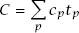
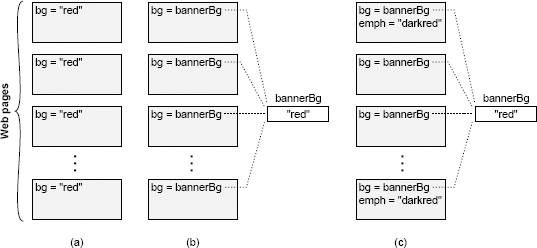

# 第 2 章 复杂性的本质

本书讨论如何设计软件系统，让系统的复杂性尽可能低。第一步是了解我们要对付的对象。究竟什么是“复杂性”？如何判断系统是否存在不必要的复杂性？系统为什么会变得复杂？本章先从整体上回答这些问题，后续章节再深入具体的结构特征，介绍如何识别复杂性。

识别复杂性是一项关键的设计能力。它能让你在投入大量精力之前发现问题，也能帮助你在备选方案之间作出合理选择。判断一个设计是否简单，比做出一个简单的设计容易；不过，一旦能看出系统过于复杂，就可以借助这种能力来引导自己的设计理念，让它以简单为目标。如果一个设计看起来很复杂，就试试其他方案，看能否更简单。随着经验积累，你会发现某些技术往往能简化设计，另一些技术则常与复杂性相伴。这会帮助你更快地做出更简单的设计。

本章还提出了一些基本假设，为全书其余内容奠定基础。后续章节将以此为前提，进一步展开讨论并推导结论。

## 2.1 复杂性的定义

在本书中，我从实用的角度定义“复杂性”：**软件系统结构中，任何使系统难以理解和修改的因素，都属于复杂性。** 复杂性有多种表现形式。例如，可能很难看懂一段代码如何工作；做一点小改进可能要花费大量精力，或者不清楚为了这项改进必须修改系统的哪些部分；也可能很难在修复一个代码缺陷时不引入另一个缺陷。如果一个软件系统难以理解和修改，它就是复杂的；如果容易理解和修改，它就是简单的。

你还可以从成本和收益的角度来评估复杂性。在复杂的系统中，即使做很小的改进，也需要大量工作。而在一个简单的系统中，可以用更少的精力实现更大的改进。

复杂性是开发人员在某个时刻、试图达成某个目标时感受到的，不一定与系统的整体规模或功能有关。人们常用“复杂”形容功能复杂的大型系统，但如果这样的系统很容易开发和维护，按本书的定义，它就不算复杂。当然，实际上几乎所有功能复杂的大型软件系统都很难开发和维护，也符合这里对复杂性的定义，但两者并没有必然联系。规模小、功能简单的系统，也可能非常复杂。

复杂性取决于最常进行的开发活动。如果系统中某些部分非常复杂，却几乎不需要改动，那么它们对系统整体复杂性的影响就不大。可以用一个粗略的数学公式表示：

系统的总体复杂性（C），是每个部分 p 的复杂性（cp）按开发人员在该部分所花时间占总开发时间的比例（tp）加权求和的结果。把复杂性隔离到一个永远不会有人看到的地方，几乎与彻底消除它同样有效。

相比代码作者，读者更容易察觉代码的复杂性。你写的代码即使自己觉得简单，只要别人觉得复杂，它就是复杂的。遇到这种情况，值得向其他开发人员详细了解：为什么他们觉得这段代码复杂？你与他们的看法为何不同？这种差异中可能蕴含值得学习的东西。开发人员的职责不只是写出自己容易理解和修改的代码，还要让别人也能轻松理解和修改。

## 2.2 复杂性的症状

复杂性主要有以下三种表现，每一种都会让开发任务变得更困难。

**变更放大**：复杂性的第一个症状是，看似简单的变更却需要修改许多地方的代码。例如，一个网站包含多个页面，每个页面都有带背景色的横幅。在许多早期网站中，颜色分别在每个页面中指定，如图 2.1（a）所示。要更改这种网站的横幅背景色，开发人员可能必须逐个手动修改现有页面；对于拥有数千个页面的大型网站，这几乎不可能完成。幸运的是，现代网站通常采用图 2.1（b）所示的方式：在一个集中的位置指定横幅颜色，所有页面引用这个共享值。这样，只需修改一处，就能改变整个网站的横幅颜色。良好设计的目标之一，就是减少每个设计决策所影响的代码量，让设计变更不必牵动太多代码。

**认知负荷**：复杂性的第二个症状是认知负荷，即开发人员完成一项任务需要掌握多少信息。认知负荷越高，学习这些信息所需的时间就越多，遗漏重要信息而出错的风险也越大。例如，某个 C 语言函数分配一块内存，返回指向它的指针，并假定调用者会释放这块内存。这就增加了使用该函数的开发人员的认知负荷。如果没有释放内存，就会发生内存泄漏。若能调整系统，让分配内存的模块也负责释放，调用者就不必操心，认知负荷也会随之降低。认知负荷有多种来源，例如包含大量方法的 API、全局变量、不一致的做法，以及模块之间的依赖关系。

系统设计人员有时会用代码行数衡量复杂性。他们认为，实现越短就越简单，只改几行代码就一定很容易。但这种观点忽略了认知负荷带来的成本。我见过一些框架，用几行代码就能写出应用程序，可要弄清楚这几行该怎么写却极其困难。**有时，代码行数更多的方案反而更简单，因为它减轻了认知负荷。**

图 2.1：网站中的每个页面都显示一个彩色横幅。在（a）中，横幅的背景色在每个页面中都明确指定。在（b）中，共享变量保存背景色，并且每个页面都引用该变量。在（c）中，有些页面还额外显示一种用于强调的颜色，它是横幅背景色的深色调；如果背景色改变，强调色也必须跟着改变。

**未知的未知**：复杂性的第三个症状是，开发人员看不出完成任务需要修改哪些代码，或需要掌握哪些信息。图 2.1（c）说明了这个问题。网站用一个中心变量确定横幅背景色，看起来很容易修改。但有些页面还用背景色的深色调来突出显示内容，而这种深色是在各个页面中单独指定的。背景色改变时，这些强调色也必须相应改变。遗憾的是，开发人员多半意识不到这一点，所以可能只修改中心变量 `bannerBg`，而没有更新强调色。即使意识到了问题，也不清楚哪些页面使用了强调色，因而可能需要搜索网站的每个页面。

在复杂性的三种表现中，未知的未知最糟糕。你需要知道某些信息，却无从得知它们是什么，甚至不知道问题是否存在，要等到修改后出现代码缺陷才会发现。变更放大固然令人烦恼，但只要知道该改哪些代码，改完后系统就能工作。认知负荷高也会增加变更成本，但如果知道需要阅读哪些信息，变更仍很可能是正确的。遇到未知的未知时，你既不清楚该做什么，也不知道提出的方案是否有效。要确定这一点，唯一的办法是通读系统的每一行代码，而对于稍具规模的系统，这就不可能做到。即使这样做了，可能也还不够，因为变更还可能依赖某个从未记录的细微设计决策。

良好设计的最重要目标之一就是使系统 *容易理解*，这与高认知负荷和未知的未知相反。在这样的系统中，开发人员能很快弄明白现有代码如何工作，以及要做一项修改需要做些什么；不用费力思考，就能很快猜出该怎么做，而且有把握猜得没错。[第 18 章](ch18.md)讨论了使代码更容易理解的技术。

## 2.3 复杂性的原因

现在你已经从整体上了解了复杂性有哪些症状，以及它为什么会让软件开发变得困难，下一步就是弄清复杂性从何而来，这样我们才能在设计系统时避开这些问题。复杂性由两方面因素引起：*依赖性* 和 *模糊性*。本节先从整体上讨论这两个因素，后续章节再讨论它们与更具体的设计决策有什么关系。

在本书中，如果一段代码无法单独理解和修改，就存在依赖关系：这段代码以某种方式与其他代码相关，修改它时，必须考虑或修改其他代码。在图 2.1（a）的网站示例中，背景色在所有页面之间创建了依赖关系。所有页面的背景必须相同，因此只要改了一个页面的背景，所有页面的背景都得跟着改。依赖关系的另一个例子来自网络协议。通常，协议的发送方和接收方各有一套代码，但两边的代码都必须遵守这个协议。更改发送方的代码几乎总是需要在接收方进行相应的更改，反之亦然。方法的签名会在方法的实现和调用它的代码之间建立依赖关系：如果给方法增加一个新参数，所有调用该方法的地方都必须修改，传入这个参数。

依赖关系是软件的基本组成部分，不能完全消除。实际上，我们在软件设计过程中有意引入了依赖性。每次编写新类时，都会围绕该类的 API 创建依赖关系。但是，软件设计的目标之一是减少依赖关系的数量，并让剩下的依赖关系尽可能简单、明显。

再来看网站的例子。在每个页面分别指定背景的旧网站中，所有网页都是相互依赖的。新网站解决了这个问题：在一个中心位置指定背景色，并提供一个 API，各个页面在渲染时通过它获取这个颜色。新网站消除了页面之间的依赖关系，但又围绕这个获取背景色的 API 产生了新的依赖关系。幸运的是，新的依赖关系更加明显：每个网页显然都依赖 `bannerBg` 颜色，开发人员只要搜索这个变量名，就能轻松找到所有使用它的地方。此外，编译器还有助于管理 API 依赖性：如果共享变量的名称发生变化，任何仍使用旧名称的代码都将发生编译错误。新网站用一个更简单、更明显的依赖关系，取代了原来那个不明显又难以管理的依赖关系。

复杂性的第二个原因是模糊性：重要信息不够明显，让人难以察觉。一个简单的例子是变量名过于笼统，无法传达多少有用信息（例如 `time`）。又如，变量的文档没有说明单位，开发人员就只能搜索代码中使用它的位置来判断。模糊性常与依赖关系有关：依赖关系存在，却不容易看出来。例如，给系统增加一种错误状态时，可能还需要在存储各状态对应消息的表中添加条目，但只看状态声明的程序员未必知道这张表的存在。不一致也是模糊性的重要来源：同一个变量名用于两种不同目的时，开发人员就难以判断某个具体变量的用途。

在许多情况下，模糊性来源于文档的不足。[第 13 章](ch13.md)讨论了这个主题。但是，模糊性也是设计问题。如果系统的设计整洁、易理解，所需的文档就会更少。需要大量文档，往往是一个危险信号，说明设计还不太对。减少模糊性的最佳方法是简化系统设计。

依赖性和模糊性共同造成了第 2.2 节描述的三种复杂性表现。依赖性导致变更放大和高认知负荷。模糊性会产生未知的未知，还会增加认知负荷。如果能找到把依赖性和模糊性降到最低的设计技术，就能降低软件的复杂性。

## 2.4 复杂性是增量产生的

复杂性并非源于某个灾难性的错误，而是由许多小问题逐渐积累而成。单个依赖关系或一处含糊不清的地方，本身不太可能显著影响软件系统的可维护性。但随着时间推移，成百上千的这类问题不断积累，最终多到每次修改系统都会受到其中若干问题的影响。

复杂性是一点一点累积起来的，这让它难以控制。你很容易说服自己，当前这次修改带来的一点点复杂性没什么大不了。但是，如果每个开发人员每次修改时都抱着这种态度，复杂性就会迅速累积。复杂性一旦积累起来，就很难消除，因为单独修复一个依赖关系或一处含糊不清的地方，本身起不了多大作用。为了减缓复杂性的增长，你必须采用[第 3 章](ch03.md)中讨论的“零容忍”理念。

## 2.5 结论

复杂性来自依赖性和模糊性的积累。随着复杂性增加，就会出现变更放大、较高的认知负荷和未知的未知。因此，每实现一个新功能，都需要修改更多代码。开发人员也要花更多时间收集信息，才能安全地进行变更；最坏的情况下，甚至无法找到全部所需信息。归根结底，复杂性让修改现有代码库变得困难而危险。
