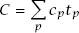
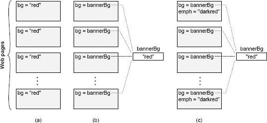

# 第 2 章 複雜性的本質

本書討論如何設計軟體系統，讓系統的複雜性儘可能低。第一步是瞭解我們要對付的物件。究竟什麼是“複雜性”？如何判斷系統是否存在不必要的複雜性？系統為什麼會變得複雜？本章先從整體上回答這些問題，後續章節再深入具體的結構特徵，介紹如何識別複雜性。

識別複雜性是一項關鍵的設計能力。它能讓你在投入大量精力之前發現問題，也能幫助你在備選方案之間作出合理選擇。判斷一個設計是否簡單，比做出一個簡單的設計容易；不過，一旦能看出系統過於複雜，就可以藉助這種能力來引導自己的設計理念，讓它以簡單為目標。如果一個設計看起來很複雜，就試試其他方案，看能否更簡單。隨著經驗積累，你會發現某些技術往往能簡化設計，另一些技術則常與複雜性相伴。這會幫助你更快地做出更簡單的設計。

本章還提出了一些基本假設，為全書其餘內容奠定基礎。後續章節將以此為前提，進一步展開討論並推導結論。

## 2.1 複雜性的定義

在本書中，我從實用的角度定義“複雜性”：**軟體系統結構中，任何使系統難以理解和修改的因素，都屬於複雜性。** 複雜性有多種表現形式。例如，可能很難看懂一段程式碼如何工作；做一點小改進可能要花費大量精力，或者不清楚為了這項改進必須修改系統的哪些部分；也可能很難在修復一個程式碼缺陷時不引入另一個缺陷。如果一個軟體系統難以理解和修改，它就是複雜的；如果容易理解和修改，它就是簡單的。

你還可以從成本和收益的角度來評估複雜性。在複雜的系統中，即使做很小的改進，也需要大量工作。而在一個簡單的系統中，可以用更少的精力達成更大的改進。

複雜性是開發人員在某個時刻、試圖達成某個目標時感受到的，不一定與系統的整體規模或功能有關。人們常用“複雜”形容功能複雜的大型系統，但如果這樣的系統很容易開發和維護，按本書的定義，它就不算複雜。當然，實際上幾乎所有功能複雜的大型軟體系統都很難開發和維護，也符合這裡對複雜性的定義，但兩者並沒有必然聯絡。規模小、功能簡單的系統，也可能非常複雜。

複雜性取決於最常進行的開發活動。如果系統中某些部分非常複雜，卻幾乎不需要改動，那麼它們對系統整體複雜性的影響就不大。可以用一個粗略的數學公式表示：

系統的總體複雜性（C），是每個部分 p 的複雜性（cp）按開發人員在該部分所花時間佔總開發時間的比例（tp）加權求和的結果。把複雜性隔離到一個永遠不會有人看到的地方，幾乎與徹底消除它同樣有效。

相比程式碼作者，讀者更容易察覺程式碼的複雜性。你寫的程式碼即使自己覺得簡單，只要別人覺得複雜，它就是複雜的。遇到這種情況，值得向其他開發人員詳細瞭解：為什麼他們覺得這段程式碼複雜？你與他們的看法為何不同？這種差異中可能蘊含值得學習的東西。開發人員的職責不只是寫出自己容易理解和修改的程式碼，還要讓別人也能輕鬆理解和修改。

## 2.2 複雜性的症狀

複雜性主要有以下三種表現，每一種都會讓開發任務變得更困難。

**變更放大**：複雜性的第一個症狀是，看似簡單的變更卻需要修改許多地方的程式碼。例如，一個網站包含多個頁面，每個頁面都有帶背景色的橫幅。在許多早期網站中，顏色分別在每個頁面中指定，如圖 2.1（a）所示。要更改這種網站的橫幅背景色，開發人員可能必須逐個手動修改現有頁面；對於擁有數千個頁面的大型網站，這幾乎不可能完成。幸運的是，現代網站通常採用圖 2.1（b）所示的方式：在一個集中的位置指定橫幅顏色，所有頁面引用這個共享值。這樣，只需修改一處，就能改變整個網站的橫幅顏色。良好設計的目標之一，就是減少每個設計決策所影響的程式碼量，讓設計變更不必牽動太多程式碼。

**認知負荷**：複雜性的第二個症狀是認知負荷，即開發人員完成一項任務需要掌握多少資訊。認知負荷越高，學習這些資訊所需的時間就越多，遺漏重要資訊而出錯的風險也越大。例如，某個 C 語言函式分配一塊記憶體，回傳指向它的指標，並假定呼叫者會釋放這塊記憶體。這就增加了使用該函式的開發人員的認知負荷。如果沒有釋放記憶體，就會發生記憶體洩漏。若能調整系統，讓分配記憶體的模組也負責釋放，呼叫者就不必操心，認知負荷也會隨之降低。認知負荷有多種來源，例如包含大量方法的 API、全域變數、不一致的做法，以及模組之間的依賴關係。

系統設計人員有時會用程式碼行數衡量複雜性。他們認為，實作越短就越簡單，只改幾行程式碼就一定很容易。但這種觀點忽略了認知負荷帶來的成本。我見過一些框架，用幾行程式碼就能寫出應用程式，可要弄清楚這幾行該怎麼寫卻極其困難。**有時，程式碼行數更多的方案反而更簡單，因為它減輕了認知負荷。**

圖 2.1：網站中的每個頁面都顯示一個彩色橫幅。在（a）中，橫幅的背景色在每個頁面中都明確指定。在（b）中，共享變數儲存背景色，並且每個頁面都引用該變數。在（c）中，有些頁面還額外顯示一種用於強調的顏色，它是橫幅背景色的深色調；如果背景色改變，強調色也必須跟著改變。

**未知的未知**：複雜性的第三個症狀是，開發人員看不出完成任務需要修改哪些程式碼，或需要掌握哪些資訊。圖 2.1（c）說明了這個問題。網站用一個中心變數確定橫幅背景色，看起來很容易修改。但有些頁面還用背景色的深色調來突出顯示內容，而這種深色是在各個頁面中單獨指定的。背景色改變時，這些強調色也必須相應改變。遺憾的是，開發人員多半意識不到這一點，所以可能只修改中心變數 `bannerBg`，而沒有更新強調色。即使意識到了問題，也不清楚哪些頁面使用了強調色，因而可能需要搜尋網站的每個頁面。

在複雜性的三種表現中，未知的未知最糟糕。你需要知道某些資訊，卻無從得知它們是什麼，甚至不知道問題是否存在，要等到修改後出現程式碼缺陷才會發現。變更放大固然令人煩惱，但只要知道該改哪些程式碼，改完後系統就能工作。認知負荷高也會增加變更成本，但如果知道需要閱讀哪些資訊，變更仍很可能是正確的。遇到未知的未知時，你既不清楚該做什麼，也不知道提出的方案是否有效。要確定這一點，唯一的辦法是通讀系統的每一行程式碼，而對於稍具規模的系統，這就不可能做到。即使這樣做了，可能也還不夠，因為變更還可能依賴某個從未記錄的細微設計決策。

良好設計的最重要目標之一就是使系統 *容易理解*，這與高認知負荷和未知的未知相反。在這樣的系統中，開發人員能很快弄明白現有程式碼如何工作，以及要做一項修改需要做些什麼；不用費力思考，就能很快猜出該怎麼做，而且有把握猜得沒錯。[第 18 章](ch18.md)討論了使程式碼更容易理解的技術。

## 2.3 複雜性的原因

現在你已經從整體上了解了複雜性有哪些症狀，以及它為什麼會讓軟體開發變得困難，下一步就是弄清複雜性從何而來，這樣我們才能在設計系統時避開這些問題。複雜性由兩方面因素引起：*依賴性* 和 *模糊性*。本節先從整體上討論這兩個因素，後續章節再討論它們與更具體的設計決策有什麼關係。

在本書中，如果一段程式碼無法單獨理解和修改，就存在依賴關係：這段程式碼以某種方式與其他程式碼相關，修改它時，必須考慮或修改其他程式碼。在圖 2.1（a）的網站範例中，背景色在所有頁面之間建立了依賴關係。所有頁面的背景必須相同，因此只要改了一個頁面的背景，所有頁面的背景都得跟著改。依賴關係的另一個例子來自網路協議。通常，協議的傳送方和接收方各有一套程式碼，但兩邊的程式碼都必須遵守這個協議。更改傳送方的程式碼幾乎總是需要在接收方進行相應的更改，反之亦然。方法的簽名會在方法的實作和呼叫它的程式碼之間建立依賴關係：如果給方法增加一個新參數，所有呼叫該方法的地方都必須修改，傳入這個參數。

依賴關係是軟體的基本組成部分，不能完全消除。實際上，我們在軟體設計過程中有意引入了依賴性。每次編寫新類時，都會圍繞該類的 API 建立依賴關係。但是，軟體設計的目標之一是減少依賴關係的數量，並讓剩下的依賴關係儘可能簡單、明顯。

再來看網站的例子。在每個頁面分別指定背景的舊網站中，所有網頁都是相互依賴的。新網站解決了這個問題：在一個中心位置指定背景色，並提供一個 API，各個頁面在渲染時透過它獲取這個顏色。新網站消除了頁面之間的依賴關係，但又圍繞這個獲取背景色的 API 產生了新的依賴關係。幸運的是，新的依賴關係更加明顯：每個網頁顯然都依賴 `bannerBg` 顏色，開發人員只要搜尋這個變數名，就能輕鬆找到所有使用它的地方。此外，編譯器還有助於管理 API 依賴性：如果共享變數的名稱發生變化，任何仍使用舊名稱的程式碼都將發生編譯錯誤。新網站用一個更簡單、更明顯的依賴關係，取代了原來那個不明顯又難以管理的依賴關係。

複雜性的第二個原因是模糊性：重要資訊不夠明顯，讓人難以察覺。一個簡單的例子是變數名過於籠統，無法傳達多少有用資訊（例如 `time`）。又如，變數的文件沒有說明單位，開發人員就只能搜尋程式碼中使用它的位置來判斷。模糊性常與依賴關係有關：依賴關係存在，卻不容易看出來。例如，給系統增加一種錯誤狀態時，可能還需要在儲存各狀態對應訊息的表中新增條目，但只看狀態宣告的程式設計師未必知道這張表的存在。不一致也是模糊性的重要來源：同一個變數名用於兩種不同目的時，開發人員就難以判斷某個具體變數的用途。

在許多情況下，模糊性來源於文件的不足。[第 13 章](ch13.md)討論了這個主題。但是，模糊性也是設計問題。如果系統的設計整潔、易理解，所需的文件就會更少。需要大量文件，往往是一個危險訊號，說明設計還不太對。減少模糊性的最佳方法是簡化系統設計。

依賴性和模糊性共同造成了第 2.2 節描述的三種複雜性表現。依賴性導致變更放大和高認知負荷。模糊性會產生未知的未知，還會增加認知負荷。如果能找到把依賴性和模糊性降到最低的設計技術，就能降低軟體的複雜性。

## 2.4 複雜性是增量產生的

複雜性並非源於某個災難性的錯誤，而是由許多小問題逐漸積累而成。單個依賴關係或一處含糊不清的地方，本身不太可能顯著影響軟體系統的可維護性。但隨著時間推移，成百上千的這類問題不斷積累，最終多到每次修改系統都會受到其中若干問題的影響。

複雜性是一點一點累積起來的，這讓它難以控制。你很容易說服自己，當前這次修改帶來的一點點複雜性沒什麼大不了。但是，如果每個開發人員每次修改時都抱著這種態度，複雜性就會迅速累積。複雜性一旦積累起來，就很難消除，因為單獨修復一個依賴關係或一處含糊不清的地方，本身起不了多大作用。為了減緩複雜性的增長，你必須採用[第 3 章](ch03.md)中討論的“零容忍”理念。

## 2.5 結論

複雜性來自依賴性和模糊性的積累。隨著複雜性增加，就會出現變更放大、較高的認知負荷和未知的未知。因此，每實作一個新功能，都需要修改更多程式碼。開發人員也要花更多時間收集資訊，才能安全地進行變更；最壞的情況下，甚至無法找到全部所需資訊。歸根結底，複雜性讓修改現有程式碼庫變得困難而危險。
