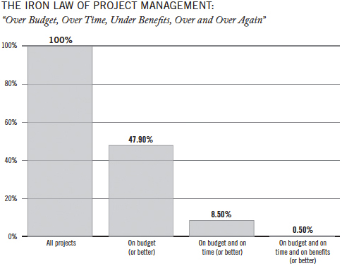

# 1. Think Slow, Act Fast

*The record of big projects is even worse than it seems. But there is a solution: Speed up by slowing down.*

Denmark is a peninsula with islands scattered along its east coast. Danes therefore long ago became experts at operating ferries and building bridges. So it was no surprise, in the late 1980s, when the government announced the Great Belt project. It comprised two bridges, one of which would be the world’s longest suspension bridge, to connect two of the bigger islands, including the one with Copenhagen on it. There would also be an underwater tunnel for trains—the second longest in Europe—which would be built by a Danish-led contractor. That was interesting because Danes had little experience boring tunnels. I watched the announcement on the news with my father, who worked in bridge and tunnel construction. “Bad idea,” he grumbled. “If I were digging a hole that big, I would hire someone who had done it before.”

Things went wrong from the start. First there was a yearlong delay in delivering four giant tunnel-boring machines. Then, as soon as the machines were in the ground, they proved to be flawed and needed redesign, delaying work another five months. Finally, the big machines started slowly chewing their way under the ocean floor.

Up above, the bridge builders brought in a massive oceangoing dredger to prepare their worksite.[^1] To do its work, the dredger stabilized itself by lowering giant support legs into the seafloor. When the work was done, the legs were lifted, leaving deep holes. By accident, one of the holes happened to be on the projected path of the tunnel. Neither the bridge builders nor the tunnelers saw the danger.

One day, after a few weeks of boring, one of the four machines was stopped for maintenance. It was about 250 meters (820 feet) out to sea and an assumed 10 meters (33 feet) under the seafloor. Water was seeping into the maintenance area in front of the machine, and a contractor unfamiliar with tunneling hooked up a pump to get the water out. The cables of the pump were trailed through a manhole into the boring machine. Suddenly water started pouring in at a speed indicating a breach of the tunnel. Evacuation was immediate—with no time to remove the pump and cables and close the manhole.

The machine and the whole tunnel flooded. So did a parallel tunnel and the boring machine within it.

Luckily, no one was injured or killed. But the salt water in the tunnel was like acid to its metal and electronics. Engineers on the project told me at the time that it would be cheaper to abandon the tunnel and start again rather than pull out the borers, drain the tunnel, and repair it. But politicians overrode them because an abandoned tunnel would be too embarrassing. Inevitably, the whole project came in very late and way over budget.

This story isn’t all that unusual. There are lots more like it in the annals of big projects. But it was that project that nudged me to start a big project of my own—a database of big projects. It continues to grow. In fact, it is now the world’s largest of its kind.

And it has a great deal to teach us about what works, what doesn’t, and how to do better.

## Honest Numbers

After the accident, the recovery, and the eventual completion of the Great Belt bridges and tunnel, everyone agreed that the project had gone badly over budget. But by how much? Management said 29 percent for the whole project. I dug into the data, did my own analysis, and discovered that their number was, shall we say, optimistic. The actual overrun was 55 percent, and 120 percent for the tunnel alone (in real terms, measured from the final investment decision). Still, management kept repeating their number in public, and I kept correcting them, until they did a public opinion poll that showed that the public sided with me. Then they gave up. Later, an official national audit confirmed my numbers, and the case was closed.[^2]

That experience taught me that megaproject management may not be a field of what University of Washington public affairs professor Walter Williams called “honest numbers.”[^3] As simple as it should be in theory to judge projects, in practice it’s anything but. In every big project, there are blizzards of numbers generated at different stages by different parties. Finding the right ones—those that are valid and reliable—takes skill and work. Even trained scholars get it wrong.[^4] And it doesn’t help that big projects involve money, reputations, and politics. Those who have much to lose will spin the numbers, so you cannot trust them. That’s not fraud. Or rather, it’s not usually fraud; it’s human nature. And with so many numbers to choose from, spinning is a lot easier than finding the truth.

This is a serious problem. Projects are promised to be completed by a certain time, at a certain cost, with certain benefits produced as a result—benefits being things such as revenues, savings, passengers moved, or megawatts of electricity generated. So how often do projects deliver as promised? That is the most straightforward question anyone could ask. But when I started to look around in the 1990s, I was stunned to discover that no one could answer it. The data simply hadn’t been collected and analyzed. That made no sense when *trillions* of dollars had been spent on the giant projects increasingly being called megaprojects—projects with budgets in excess of $1 billion.

Our database started with transportation projects: the Holland Tunnel in New York; the BART system in San Francisco; the Channel Tunnel in Europe; bridges, tunnels, highways, and railways built throughout the twentieth century. It took five years, but with my team I got 258 projects into the database, making it the biggest of its kind at the time.[^5] When we finally began publishing the numbers in 2002, it made waves because nothing like it had been done before.[^6] Also, the picture that emerged wasn’t pretty.

“Project estimates between 1910 and 1998 were short of the final costs an average of 28 percent,” according to *The New York Times,* summarizing our findings. “The biggest errors were in rail projects, which ran, on average, 45 percent over estimated costs [in inflation-adjusted dollars]. Bridges and tunnels were 34 percent over; roads, 20 percent. Nine of 10 estimates were low, the study said.”[^7] The results for time and benefits were similarly bad.

And these are conservative readings of the data. Measured differently—from an earlier date and including inflation—the numbers are *much* worse.[^8]

The global consultancy McKinsey got in touch with me and proposed that we do joint research. Its researchers had started investigating major information technology projects—the biggest of which cost more than $10 billion—and their preliminary numbers were so dismal that they said it would take a big improvement for IT projects to rise to the level of awfulness of transportation projects. I laughed. It seemed impossible that IT could be that bad. But I worked with McKinsey, and indeed we found that IT disasters were even worse than transportation disasters. But otherwise it was a broadly similar story of cost and schedule overruns and benefit shortfalls.[^9]

That was startling. Think of a bridge or a tunnel. Now picture the US government’s HealthCare.gov website, which was a mess when it first opened as the “Obamacare” enrollment portal. Or imagine the information system used by the National Health Service in the United Kingdom. These IT projects are made of code, not steel and concrete. They would seem to be different from transportation infrastructure in every possible way. So why would their outcomes be statistically so similar, with consistent cost and schedule overruns and benefit shortfalls?

We shifted our research to mega-events such as the Olympic Games and got the same result. Big dams? Same again. Rockets? Defense? Nuclear power? The same. Oil and gas projects? Mining? Same. Even something as common as building museums, concert halls, and skyscrapers fit the pattern. I was astonished.[^10]

And the problem wasn’t limited to any country or region; we found the same pattern all over the world.[^11] The famously efficient Germans have some remarkable examples of bloat and waste, including Berlin’s new Brandenburg Airport, which was years delayed and billions of euros over budget, hovering on the verge of bankruptcy only a year after opening in October 2020.[^12]

Even Switzerland, the nation of precise clocks and punctual trains, has its share of embarrassing projects; for instance, the Lötschberg Base Tunnel, which was completed late and with a cost overrun of 100 percent.

## Over Budget, Over Time, Over and Over Again

The pattern was so clear that I started calling it the “Iron Law of Megaprojects”: over budget, over time, under benefits, over and over again.[^13]

The Iron Law is not a “law” like in Newtonian physics, meaning something that invariably produces the same outcome. I study people. In the social sciences, “laws” are probabilistic (they are in natural science, too, but Isaac Newton didn’t pay much attention to that). And the probability that any big project will blow its budget and schedule and deliver disappointing benefits is very high and very reliable.

The database that started with 258 projects now contains more than 16,000 projects from 20-plus different fields in 136 countries on all continents except Antarctica, and it continues to grow. There are some recent and important wrinkles in the numbers, which I’ll discuss later, but the general story remains the same: In total, only 8.5 percent of projects hit the mark on both cost and time. And a minuscule 0.5 percent nail cost, time, and benefits. Or to put that another way, 91.5 percent of projects go over budget, over schedule, or both. And 99.5 percent of projects go over budget, over schedule, under benefits, or some combination of these. Doing what you said you would do should be routine, or at least common. But it almost never happens.

Graphically, the Iron Law looks like this:

Tellingly, the 0.5 percent of projects that are on budget, time, and benefits are nearly invisible to the naked eye. It’s hard to overstate how bad that record is. For anyone contemplating a big project, it is truly depressing. But as grim as those numbers are, they don’t tell the full truth—which is *much* worse.

From experience, I know that most people are aware that cost and time overruns are common. They don’t know *how* common—they are usually shocked when I show them my numbers—but they definitely know that if they lead a big project, they should consider and protect themselves against overruns, particularly cost overruns. The obvious way to do that is to build a buffer into the budget. You hope it won’t be needed, but you’ll be covered just in case. How big should that buffer be? Typically, people make it 10 percent or 15 percent.

But let’s say you are an unusually cautious person and you are planning the construction of a large building. You put a 20 percent buffer into the budget and think you are now well protected. But then you come across my research and discover that the actual mean cost overrun of a major building project is 62 percent. That is heart-stopping. It may also be project-stopping. But let’s say you are the very rare planner who can get your financial backers to cover that risk and still go ahead with the project. You now have an extraordinary 62 percent buffer built into your budget. In the real world, that almost never happens. But you’re one of the fortunate few. Are you at last protected? No. In fact, you have *still* drastically underestimated the danger.

That’s because you have assumed that if you are hit with a cost overrun, it will be somewhere around the mean—or 62 percent. Why did you assume that? Because it would be true if the cost overruns followed what statisticians call a “normal distribution.” That’s the famous bell curve, which looks like a bell when graphed. Much of statistics is built upon bell curves—sampling, averages, standard deviations, the law of large numbers, regression to the mean, statistical tests—and it has filtered into the culture and into the popular imagination, where it fits well with how we intuitively grasp risk. In a normal distribution, results are overwhelmingly lumped in the middle and there are very few or no extreme observations at either end—the so-called tails of the distribution. These tails are therefore said to be *thin.*

Height is normally distributed. Depending on where you live, most adult males are around five feet, nine inches (1.75 meters) tall, and the tallest person in the world is only about 1.6 times taller than that.[^14]

But the “normal” distribution isn’t the only sort of distribution that exists—or even the most common one. So it is not normal in that sense of the word. There are other distributions that are called “fat-tailed” because, compared with normal distributions, they contain far more extreme outcomes in their tails.

Wealth, for example, is fat-tailed. At the time of writing, the wealthiest person in the world is 3,134,707 times wealthier than the average person. If human height followed the same distribution as human wealth, the tallest person in the world would not be 1.6 times taller than the average person; he would be 3,311 miles (5,329 kilometers) tall, meaning that his head would be thirteen times farther into outer space than the International Space Station.[^15]

So the critical question is this: Are project outcomes distributed “normally,” or do they have fat tails? My database revealed that information technology projects have fat tails. To illustrate, 18 percent of IT projects have cost overruns above 50 percent in real terms. And for those projects the average overrun is 447 percent! That’s the *average* in the tail, meaning that many IT projects in the tail have even higher overruns than this. Information technology is *truly* fat-tailed![^16] So are nuclear storage projects. And the Olympic Games. And nuclear power plants. And big hydroelectric dams. As are airports, defense projects, big buildings, aerospace projects, tunnels, mining projects, high-speed rail, urban rail, conventional rail, bridges, oil projects, gas projects, and water projects. (See Appendix A.)

In fact, most project types have fat tails. How “fat” their tails are—how many projects fall into the extremes and how extreme those extremes are—does vary. I’ve cited them in order, from fattest to least fat (but still fat)—or, if you prefer, from most at risk of terrifying overruns to less at risk (but still very much at risk).[^17]

There *are* a few project types that do not have fat tails. That’s important. I’ll explain why, and how we can all make use of this fact, in the last chapter.

But for now the lesson is simple, clear, and scary: Most big projects are not merely at risk of not delivering as promised. Nor are they only at risk of going seriously wrong. They are at risk of going *disastrously* wrong because their risk is fat-tailed. Against that background, it is interesting to note that the project management literature almost completely ignores systematic study of the fat-tailedness of project risk.

What do fat-tailed outcomes look like? Boston’s “Big Dig”—replacing an elevated highway with a tunnel, with construction started in 1991—put the city through the wringer for sixteen years and cost more than *triple* what it was supposed to. NASA’s James Webb Space Telescope, which is now almost a million miles from Earth, was forecast to take twelve years but required nineteen to complete, while its final cost of $8.8 billion was an astronomical—forgive me—450 percent over budget. Canada’s firearms registry, an IT project, went 590 percent over budget. And then there is Scotland’s Parliament Building. When it opened in 2004, it was three years late and a bagpipe-exploding 978 percent over budget.

Nassim Nicholas Taleb famously dubbed low-probability, high-consequence events “black swans.” Disastrous project outcomes such as these can end careers, sink companies, and inflict a variety of other carnage. They definitely qualify as black swans.

Just look at what a black swan outcome did to Kmart: Responding to competitive pressure from Walmart and Target, it launched two enormous IT projects in 2000. Costs exploded, contributing directly to the company’s decision to file for bankruptcy in 2002.[^18] Or consider what another IT blowout did to the legendary jeans maker Levi Strauss: Originally forecast to cost $5 million, the project forced the company to take a $200 million loss and show its CIO the door.[^19]

There are worse fates for executives. When a troubled nuclear power plant project in South Carolina fell badly behind schedule, the CEO of the company in charge withheld that information from regulators “in an effort to keep the project going,” noted a 2021 US Department of Justice press release, which also announced that the executive had been sentenced to two years in federal prison and forced to pay $5.2 million in forfeitures and fines.[^20] Black swan outcomes do indeed have consequences for projects and those who lead them.

If you are not a corporate executive or government official, and if the ambitious project you are contemplating is on a much smaller scale than these giants, it may be tempting to think that none of this applies to you. Resist that temptation. My data show that smaller projects are susceptible to fat tails, too. Moreover, fat-tailed distributions, not normal distributions, are typical within complex systems, both natural and human, and we all live and work within increasingly complex systems, which means increasingly interdependent systems. Cities and towns are complex systems. Markets are complex systems. Energy production and distribution are complex systems. Manufacturing and transportation are complex systems. Debt is a complex system. So are viruses. And climate change. And globalization. On and on the list goes. If your project is ambitious and depends on other people and many parts, it is all but certain that your project is embedded in complex systems.

That describes projects of all types and scales, all the way down to home renovations. A few years ago, in a BBC show about renovating historic British properties, one episode featured a London couple who bought a run-down house in the countryside and got a builder to estimate the cost of a complete renovation. He pegged it at $260,000. Eighteen months later, the project was far from done and the couple had already spent $1.3 million.[^21] That is the sort of overrun we would expect to find in a fat-tailed distribution. And it is certainly not unique. Later in the book, we’ll witness a home renovation in Brooklyn spin wildly out of control and inflict an equally devastating overrun on the unfortunate and unexpecting homeowners.

That London couple were apparently wealthy enough to keep funding the renovation. Similarly, major corporations on the hook for runaway projects may be able to keep things going by borrowing more and more money. Governments can also pile up debt. Or raise taxes. But most ordinary folks and small businesses cannot draw on a big stockpile of wealth, run up debt, or raise taxes. If they start a project that hurtles toward the fat tail of the distribution, they will simply be wiped out, giving them even more reason than a corporate executive or government official to take the danger seriously.

And that starts by understanding what causes project failure.

## The Window of Doom

The patterns I mentioned earlier, confirmed by my data, are strong clues: Projects that fail tend to drag on, while those that succeed zip along and finish.

Why is that? Think of the duration of a project as an open window. The longer the duration, the more open the window. The more open the window, the more opportunity for something to crash through and cause trouble, including a big, bad black swan.

What could that black swan be? Almost anything. It could be something dramatic, like an election upset, a stock market collapse, or a pandemic. After Covid-19 emerged in January 2020, projects all over the world—from the 2020 Tokyo Olympics to the release of the James Bond movie *No Time to Die*—were delayed, postponed, or scrapped altogether. Events such as these may be extremely unlikely on any given day, month, or year. But the more time that passes from the decision to do a project to its delivery, the greater their probability.

Notice that these big, dramatic events, which are easily capable of damaging a project so badly that it delivers a black swan outcome, are themselves low probability and high consequence. That is, they are black swans. So a black swan crashing through the window of vulnerability may itself cause a black swan outcome.

But drama isn’t necessary for change to batter and bury projects. Even mundane change can do that. Journalists who write biographies of up-and-coming politicians know, for example, that the market for their books depends on the politician continuing to be on the rise when the book is released. Any number of events can change that: a scandal, a lost election; an illness; a death. Even something as simple as the politician getting bored with politics and taking another job would ruin the project. Again, the more time that passes from decision to delivery, the greater the probability of one or more of these events happening. It’s even possible that trivial events, in just the wrong circumstances, can have devastating consequences.

It’s hard to think of anything more trivial to most people around the world than gusts of wind in the Egyptian desert. Yet on March 23, 2021, it was just such gusts, at just the wrong moment, that pushed the bow of *Ever Given,* a giant container ship, into a bank of the Suez Canal. The ship got stuck and couldn’t be budged for six days, blocking the canal, halting hundreds of ships, freezing an estimated $10 billion in trade each day, and sending shocks rippling through global supply chains.[^22] The people and projects who suffered as a result of those supply-chain troubles may never have realized it, but the cause of their trouble was ultimately strong winds in a faraway desert.[^23]

A complex systems theorist might describe what happened by saying that the dynamic interdependencies among the parts of the system—the wind, the canal, the ship, and supply chains—created strong nonlinear responses and amplification. In plain English, minor changes combined in a way to produce a disaster. In complex systems, that happens so often that the Yale sociologist Charles Perrow called such events “normal accidents.”[^24]

Growing complexity and interdependency may make such outcomes more likely in today’s world, but they are hardly a new phenomenon. A proverb that originated in the Middle Ages and comes in many forms tells us, “For want of a nail, the shoe was lost. For want of a shoe, the horse was lost. For want of a horse, the rider was lost. For want of a rider, the battle was lost. For want of a battle, the kingdom was lost.” This version was published by Benjamin Franklin in 1758, and he introduced it with the warning that “a little neglect may breed great mischief.” The key word is *may*. Most nails can be lost without anything bad happening at all. A few such losses will have consequences, but they will be minor, like the loss of one horse or one rider. But sometimes a lost nail may cause something truly terrible.

From the dramatic to the mundane to the trivial, change can rattle or ruin a project—if it occurs during the window of time when the project is ongoing.

Solution? Close the window.

Of course, a project can’t be completed instantly, so we can’t close the window entirely. But we can make the opening radically smaller by speeding up the project and bringing it to a conclusion faster. That is a main means of reducing risk on any project.

In sum, keep it short!

## The Need for Speed

How do we get a project done as quickly as possible? The obvious answer—and certainly the most common one—is to set severe timelines, get started right away, and demand that everyone involved work at a furious pace. Drive and ambition are key, goes the conventional wisdom. If experienced observers think a project will take two years, say you will do it in one. Commit to the project, heart and soul, and charge ahead. And in managing others, be fierce. Demand that everything be done yesterday. Like the drummer on a Roman galley preparing to ram a ship, beat the drum at a furious pace.

This thinking is as misguided as it is common. There is a monument to it in Copenhagen.

The Copenhagen Opera House, the home of the Royal Danish Opera, was the vision of Arnold Maersk Mc-Kinney Møller, the CEO and chairman of Maersk, the Danish shipping giant. In the late 1990s, Møller, who was then in his late eighties, decided he wanted a grand building situated prominently at the harborside as his very visible and permanent legacy. And he wanted it designed and built quickly. The queen of Denmark would attend the opening, and Møller had no intention of missing his big night. When Møller asked the architect, Henning Larsen, how long it would take, Larsen said five years. “You’ll get four!” Møller curtly responded.[^25] With much beating of galley drums, the deadline was met, and Møller and the queen opened the opera house together on January 15, 2005.

But the cost of that haste was terrible, and not only in terms of cost overruns. Larsen was so appalled by the completed building that he wrote a whole book to clear his reputation and explain the confused structure, which he called a “mausoleum.”

Haste makes waste.

Even that cost is mild compared to what rushing projects this way can do. In 2021, after an overpass collapsed beneath a metro train in Mexico City, three independent investigations concluded that rushed, shoddy work was to blame. A Norwegian firm hired by the city to conduct an investigation concluded that the tragedy had been caused by “deficiencies in the construction process,” as did a later report released by the attorney general of Mexico City.[^26] *The New York Times* did its own investigation and concluded that the city’s insistence that construction be completed before the city’s powerful mayor was due to leave office had been a key contributing cause of the collapse. “The scramble led to a frenzied construction process that began before a master plan had been finalized and produced a metro line with defects from the start,” the *Times* concluded.[^27] The collapse of the overpass killed twenty-six people. Haste makes not only waste but tragedy.

## Make Haste—Slowly

To understand the right way to get a project done quickly, it’s useful to think of a project as being divided into two phases. This is a simplification, but it works: first, planning; second, delivery. The terminology varies by industry—in movies, it’s “development and production”; in architecture, “design and construction”—but the basic idea is the same everywhere: Think first, then do.

A project begins with a vision that is, at best, a vague image of the glorious thing the project will become. Planning is pushing the vision to the point where it is sufficiently researched, analyzed, tested, and detailed that we can be confident we have a reliable road map of the way forward.

Most planning is done with computers, paper, and physical models, meaning that planning is relatively cheap and safe. Barring other time pressures, it’s fine for planning to be slow. Delivery is another matter. Delivery is when serious money is spent and the project becomes vulnerable as a consequence.

Consider a Hollywood director working on a live-action movie project in February 2020. The Covid pandemic is about to arrive. How badly will that hurt the project? The answer depends on what stage the project is in. If the director and her team are writing scripts, drawing storyboards, and scheduling location shoots—if they are planning, in other words—it’s a problem but not a disaster. In fact, a lot of the work will probably continue despite the pandemic. But what if, when the pandemic arrives, the director is filming in the streets of New York with a crew of two hundred plus a handful of very expensive movie stars? Or what if the movie is finished but still a month away from its release in theaters that are about to close indefinitely? That’s not a problem; it’s a disaster.

Planning is a safe harbor. Delivery is venturing across the storm-tossed seas. This is a major reason why, at Pixar—the legendary studio that created *Toy Story, Finding Nemo, The Incredibles, Soul,* and so many other era-defining animated movies—“directors are allowed to spend years in the development phase of a movie,” noted Ed Catmull, a co-founder of Pixar. There is a cost associated with exploring ideas, writing scripts, storyboarding images, and doing it all over and over again. But “the costs of iterations are relatively low.”[^28] And all that good work produces a rich, detailed, tested, and proven plan. When the project moves into the production phase, it will, as a consequence of all that work, be relatively smooth and quick. That’s essential, Catmull noted, because production “is where costs explode.”

Not only is it safer for planning to be slow, it is *good* for planning to be slow, as the directors at Pixar well know. After all, cultivating ideas and innovations takes time. Spotting the implications of different options and approaches takes more time. Puzzling through complex problems, coming up with solutions, and putting them to the test take still more time. Planning requires thinking—and creative, critical, careful thinking is slow.

Abraham Lincoln is reputed to have said that if he had five minutes to chop down a tree, he’d spend the first three sharpening the ax.[^29] That’s exactly the right approach for big projects: Put enormous care and effort into planning to ensure that delivery is smooth and swift.

*Think slow, act fast:* That’s the secret of success.

“Think slow, act fast” may not be a new idea. It was on grand display back in 1931, after all, when the Empire State Building raced to the sky. You could even say that the idea goes at least as far back as Rome’s first emperor, the mighty Caesar Augustus, whose personal motto was “*Festina lente,*” or “Make haste slowly.”

But “Think slow, act fast” is not how big projects are typically done. “Think fast, act slow” is. The track record of big projects unequivocally shows that.

## Projects Don’t *Go* Wrong, They *Start* Wrong

Look at California High-Speed Rail. When it was approved by voters and construction started, there were lots of documents and numbers that may have superficially resembled a plan. But there was no carefully detailed, deeply researched, and thoroughly tested program, which is to say that there was no real plan. Louis Thompson, an expert on transportation projects who chairs the California High-Speed Rail Peer Review Group convened by the California State Legislature, says that what California had in hand when the project got under way could at best be described as a “vision” or an “aspiration.”[^30] It’s no wonder that problems started multiplying and progress slowed to a crawl soon after delivery began.

That is, sadly, typical. On project after project, rushed, superficial planning is followed by a quick start that makes everybody happy because shovels are in the ground. But inevitably, the project crashes into problems that were overlooked or not seriously analyzed and dealt with in planning. People run around trying to fix things. More stuff breaks. There is more running around. I call this the “break-fix cycle.” A project that enters it is like a mammoth stuck in a tar pit.

People say that projects “go wrong,” which they all too often do. But phrasing it that way is misleading; projects don’t *go* wrong so much as they *start* wrong.

This raises an urgent question: If “Think slow, act fast” is the wise approach, why do leaders of big projects so often do the opposite? I’ll answer that question in chapter 2.

In chapter 3, I’ll look at how to start a project without stumbling into the “Think fast, act slow” tar pit.

People often think that planning is about filling in flowcharts. And too often, it is. But it shouldn’t be. In chapter 4, I’ll take a close look at what I call “Pixar planning,” how the movie studio and others use simulation and iteration to produce a plan that is creative, rigorous, detailed, and reliable—and highly likely to make delivery smooth and swift. I’ll use “Pixar planning” as a name and a model for planning, not just at Pixar but for any planning that develops a tested and tried plan; that is, a plan worthy of its name.

In chapter 5, I’ll examine the invaluable role of experience in both planning and delivery of big projects—or rather, the invaluable role it could play if it were not so often marginalized, misunderstood, or simply ignored.

In chapter 6, it’s on to forecasting. How long will the project take? How much will it cost? Setting the wrong expectations at the start can set you up for failure before you’ve even started. Fortunately, there is a fix. More fortunately, it’s surprisingly easy.

Some people will object to all this emphasis on planning. They believe that big projects, particularly creative projects such as movies, signature architecture, or innovative software, get better results when people take a leap of faith, get started right away, and rely on ingenuity to see them through. In chapter 7, I’ll examine this argument in its strongest form—and present the data to prove that it’s dead wrong.

But even the best plan won’t succeed if it doesn’t have a solid team delivering it. So in chapter 8, I’ll look at how one giant project successfully drew together thousands of people from hundreds of different organizations with different interests and turned them into a united, determined, effective team that delivered the planned benefits on time and on budget.

In the final chapter, I’ll draw on the themes of the previous chapters to explore a concept that brings them all together: modularity. Its potential is huge. Not only can it cut costs, boost quality, and speed things up for a vast array of projects from wedding cakes to subways, it can transform how we build infrastructure—and even help save the world from climate change.

But first we have to answer that question about why projects so often start prematurely. Let me tell you the story of a man in a hurry—and how he almost ruined one of the most beautiful places in the United States.

[^1]: To triangulate inside information and support my memory of events, I have relied on the following sources: Shani Wallis, “Storebaelt Calls on Project Moses for Support,” *TunnelTalk,* April 1993, https://www.tunneltalk.com/Denmark-Apr1993-Project-Moses-called-on-to-support-Storebaelt-undersea-rail-link.php; Shani Wallis, “Storebaelt—The Final Chapters,” *TunnelTalk,* May 1995, https://www.tunneltalk.com/Denmark-May1995-Storebaelt-the-final-chapters.php; “Storebaelt Tunnels, Denmark,” Constructive Developments, https://sites.google.com/site/constructivedevelopments/storebaelt-tunnels.
[^2]: De af Folketinget Valgte Statsrevisorer [National Audit Office of Denmark], *Beretning om Storebæltsforbindelsens økonomi,* beretning 4/97 (Copenhagen: Statsrevisoratet, 1998); Bent Flyvbjerg, “Why Mass Media Matter and How to Work with Them: Phronesis and Megaprojects,” in *Real Social Science: Applied Phronesis,* eds. Bent Flyvbjerg, Todd Landman, and Sanford Schram (Cambridge, UK: Cambridge University Press, 2012), 95–121.
[^3]: Walter Williams, *Honest Numbers and Democracy* (Washington, DC: Georgetown University Press, 1998).
[^4]: For examples of studies that got the data wrong, see Bent Flyvbjerg et al., “Five Things You Should Know About Cost Overrun,” *Transportation Research Part A: Policy and Practice* 118 (December 2018): 174–90.
[^5]: My main collaborator in collecting the first data set of 258 projects was Mette K. Skamris Holm, at the time a doctoral student at Aalborg University and co-author of the main publications about these data. Mette went on to have a brilliant career in planning practice. At the time of writing, she is the city engineer of Aalborg municipality, Denmark.
[^6]: Bent Flyvbjerg, Mette K. Skamris Holm, and Søren L. Buhl, “Underestimating Costs in Public Works Projects: Error or Lie?,” *Journal of the American Planning Association* 68, no. 3 (Summer 2002): 279–95; Bent Flyvbjerg, Mette K. Skamris Holm, and Søren L. Buhl, “What Causes Cost Overrun in Transport Infrastructure Projects?,” *Transport Reviews* 24, no. 1 (January 2004): 3–18; Bent Flyvbjerg, Mette K. Skamris Holm, and Søren L. Buhl, “How (In)accurate Are Demand Forecasts in Public Works Projects? The Case of Transportation,” *Journal of the American Planning Association* 71, no. 2 (Spring 2005): 131–46.
[^7]: Michael Wilson, “Study Finds Steady Overruns in Public Projects,” *The New York Times,* July 11, 2002.
[^8]: Here and elsewhere in this book, cost overruns are measured in real terms (that is, not including inflation), and with a baseline in the final business case (that is, *not* in the early outline or draft business case). This means that the overruns reported are conservative; that is, low. If inflation were included and if the baseline were set in earlier business cases, the overruns would be much higher—sometimes several times higher. In mathematical terms, cost overrun is measured in percent as O = (Ca/Ce−1) × 100, where O = percentage overrun; Ca = actual outturn cost; Ce = estimated cost at the time of the final investment decision (aka the date of decision to build or final business case), with all costs measured in constant (real) prices. For more detail about how cost overrun is measured and the pitfalls of such measurement, see Flyvbjerg et al., “Five Things You Should Know About Cost Overrun.”
[^9]: Bent Flyvbjerg and Alexander Budzier, “Why Your IT Project May Be Riskier Than You Think,” *Harvard Business Review* 89, no. 9 (September 2011): 23–25.
[^10]: For an overview, see Appendix A.
[^11]: Bent Flyvbjerg and Dirk W. Bester, “The Cost-Benefit Fallacy: Why Cost-Benefit Analysis Is Broken and How to Fix It,” *Journal of Benefit-Cost Analysis* 12, no. 3 (2021): 395–419.
[^12]: Marion van der Kraats, “BER Boss: New Berlin Airport Has Money Only Until Beginning of 2022,” *Aviation Pros,* November 1, 2021, https://www.aviationpros.com/airports/news/21244678/ber-boss-new-berlin-airport-has-money-only-until-beginning-of-2022.
[^13]: Bent Flyvbjerg, “Introduction: The Iron Law of Megaproject Management,” in *The Oxford Handbook of Megaproject Management,* ed. Bent Flyvbjerg (Oxford, UK: Oxford University Press, 2017), 1–18.
[^14]: Max Roser, Cameron Appel, and Hannah Ritchie, “Human Height,” *Our World in Data,* May 2019, https://ourworldindata.org/human-height.
[^15]: The average adult male is 175 centimeters (5 feet, 9 inches) tall. The tallest adult male is 272 centimeters (8 feet, 11 inches) tall. At the time of writing, the wealthiest person in the world was Jeff Bezos, with a net worth of $197.8 billion; average per capita wealth globally was $63,100.
[^16]: See also Bent Flyvbjerg et al., “The Empirical Reality of IT Project Cost Overruns: Discovering a Power-Law Distribution,” forthcoming in *Journal of Management Information Systems* 39, no. 3 (Fall 2022).
[^17]: For the mathematically/statistically inclined reader: In probability theory and statistics, kurtosis is a standard measure of the “tailedness” of the probability distribution of a real-valued random variable. The Gaussian (normal) distribution has a kurtosis of 3. Probability distributions with a kurtosis lower than 3 have thinner tails than the Gaussian, which is itself considered thin-tailed. Probability distributions with a kurtosis larger than 3 are considered fat-tailed. The higher above 3 the kurtosis is for a distribution (called “excess kurtosis”), the more fat-tailed the distribution is considered to be. The mathematician Benoit Mandelbrot found a kurtosis of 43.36 in a pioneering study of daily variations in the Standard & Poor’s 500 index between 1970 and 2001—14.5 times more fat-tailed than the Gaussian—which he found alarmingly high in terms of financial risk; see Benoit B. Mandelbrot and Richard L. Hudson, *The (Mis)behavior of Markets* (London: Profile Books, 2008), 96. But Mandelbrot’s finding is not particularly high when compared with the kurtosis I have found for percentage cost overruns in information technology projects, which is 642.51, or 214 times more fat-tailed than the Gaussian, or in water projects, with a kurtosis of 182.44. In fact, for the twenty-plus project types for which I have data, only a handful have a kurtosis for cost overrun that indicates a normal or near-normal distribution (the results are similar for schedule overruns and benefit shortfalls, albeit with fewer data). A large majority of project types has a kurtosis higher than 3—often much higher—indicating fat-tailed and very-fat-tailed distributions. Statistics and decision theory further talk about “kurtosis risk,” which is the risk that results when a statistical model assumes the normal (or near-normal) distribution but is applied to observations that have a tendency to occasionally be much further (in terms of number of standard deviations) from the average than is expected for a normal distribution. Project management scholarship and practice largely ignore kurtosis risk, which is unfortunate given the extreme levels of kurtosis documented above and which is a root cause of why this type of management so often goes so systematically and spectacularly wrong.
[^18]: Bent Flyvbjerg and Alexander Budzier, “Why Your IT Project May Be Riskier Than You Think.”
[^19]: Ibid.
[^20]: “Former SCANA CEO Sentenced to Two Years for Defrauding Rate-payers in Connection with Failed Nuclear Construction Program,” US Department of Justice, October 7, 2021, https://www.justice.gov/usao-sc/pr/former-scana-ceo-sentenced-two-years-defrauding-ratepayers-connection-failed-nuclear.
[^21]: *Restoration Home,* season 3, episode 8, BBC, https://www.bbc.co.uk/programmes/b039glq7.
[^22]: Alex Christian, “The Untold Story of the Big Boat That Broke the World,” *Wired,* June 22, 2021, https://www.wired.co.uk/article/ever-given-global-supply-chain.
[^23]: Motoko Rich, Stanley Reed, and Jack Ewing, “Clearing the Suez Canal Took Days. Figuring Out the Costs May Take Years,” *The New York Times,* March 31, 2021.
[^24]: Charles Perrow, *Normal Accidents: Living with High-Risk Technologies,* updated edition (Princeton, NJ: Princeton University Press, 1999).
[^25]: Henning Larsen, *De skal sige tak! Kulturhistorisk testamente om Operaen* (Copenhagen: People’s Press, 2009), 14.
[^26]: Maria Abi-Habib, Oscar Lopez, and Natalie Kitroeff, “Construction Flaws Led to Mexico City Metro Collapse, Independent Inquiry Shows,” *The New York Times,* June 16, 2021; Oscar Lopez, “Faulty Studs Led to Mexico City Metro Collapse, Attorney General Says,” *The New York Times,* October 14, 2021.
[^27]: Natalie Kitroeff et al., “Why the Mexico City Metro Collapsed,” *The New York Times,* June 13, 2021.
[^28]: Ed Catmull, *Creativity, Inc.: Overcoming the Unseen Forces That Stand in the Way of True Inspiration* (New York: Random House, 2014), 115.
[^29]: Like so many wise words ascribed to Abraham Lincoln, Winston Churchill, Mark Twain, and other notables, this quotation might not be accurate; see https://quoteinvestigator.com/2014/03/29/sharp-axe/.
[^30]: Author interview with Louis Thompson, April 22, 2020. Here and elsewhere in the book, an “author interview” is an interview carried out by one or both of the authors; that is, by Bent Flyvbjerg, Dan Gardner, or both.
