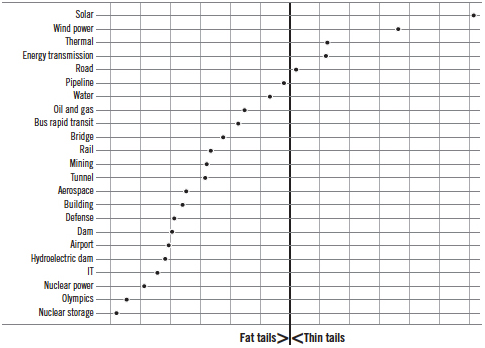
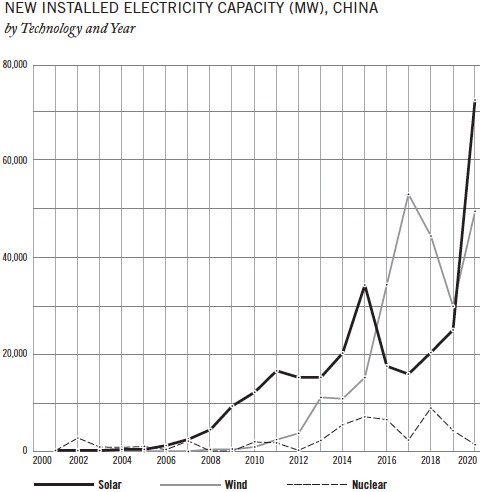

# 9. What’s Your Lego?

*Get a small thing, a basic building block. Combine it with another and another until you have what you need. That’s how a single solar cell becomes a solar panel, which becomes a solar array, which becomes a massive megawatt-churning solar farm. Modularity delivers faster, cheaper, and better, making it valuable for all project types and sizes. But for building at a truly huge scale—the scale that transforms cities, countries, even the world—modularity is not just valuable, it’s indispensable.*

In 1983, the government of Japan launched a new project that was as promising as it was enormous. Its name was Monju, meaning “wisdom.” When completed, Monju would be both a nuclear power plant churning out electricity for consumers and a fast-breeder reactor, a new type of nuclear plant that would produce fuel for the nuclear industry. For a nation long threatened by energy insecurity, Monju was designed to deliver a better future.[^1]

Construction started in 1986. It finished almost a decade later, in 1995. But a fire immediately shut down the facility. An attempt to cover up the accident became a political scandal that kept the plant closed for years.[^2]

In 2000, the Japan Atomic Energy Agency announced that the plant could restart. Japan’s supreme court finally authorized the restart in 2005. Operations were scheduled to begin in 2008, but they were postponed until 2009. Test runs started in 2010, with full operations scheduled to commence, for the first time, in 2013. But in May 2013, maintenance flaws were discovered on some fourteen thousand components of the plant, including critical safety equipment. The restart was halted. Further violations of safety protocols were uncovered. Japan’s Nuclear Regulation Authority declared Monju’s operator to be unqualified.[^3] At that point, the government had spent $12 billion and the estimated cost of finally restarting Monju and operating it for ten years was another $6 billion—at a time when the 2011 Fukushima disaster had turned popular opinion against nuclear power. The government finally threw in the towel. In 2016, it announced that Monju would be permanently closed.[^4]

Decommissioning Monju is expected to take another thirty years and cost a further $3.4 billion. If that forecast proves more accurate than the rest, the project will have taken sixty years, cost more than $15 billion, and produced zero electricity.[^5]

Monju is an extreme case, but it’s not in a category by itself. Far from it. Nuclear power plants are one of the worst-performing project types in my database, with an average cost overrun of 120 percent in real terms and schedules running 65 percent longer than planned. Even worse, they are at risk of fat-tail extremes for both cost and schedule, meaning they may go 20 or 30 percent over budget. Or 200 or 300 percent. Or 500 percent. Or more. There is almost no limit to how bad things can get, as Monju demonstrated so spectacularly.[^6]

The problem isn’t nuclear power; many other project types have track records only somewhat less bad. The problem lies in the way huge projects like Monju are typically designed and delivered. When we understand that problem, we will find a solution to building big that is, paradoxically, small. In fact, it is tiny, like a single block of Lego. But it’s remarkable what you can do with blocks of Lego, as we will see.

## One Huge Thing

One way to design and deliver a project on an enormous scale is to build one thing. One *huge* thing.

Monju is one huge thing. Most nuclear power plants are. So are giant hydroelectric dams, high-speed rail lines such as that in California, and mammoth IT projects and skyscrapers.

If you build like this, you build only one thing. By definition, that thing is one of a kind. To put that in the language of tailors, it is bespoke: no standard parts, no commercial off-the-shelf products, no simple repetition of what was done last time. And that translates into slow and complex. Nuclear power plants, for one, are the products of a staggering number of bespoke parts and systems that must all work, and work together, for the plant as a whole to work.

Complex bespokeness alone makes huge projects hard to deliver if done in this manner. But that is compounded by several more factors.

First, you can’t build a nuclear power plant quickly, run it for a while, see what works and what doesn’t, then change the design to incorporate the lessons learned. It’s too expensive and dangerous. That means that experimentation—one-half of the *experiri* I discussed in chapter 4—is out. You have no choice but to get it right the first time.

Second, there’s a problem with experience—the other half of *experiri.* If you are building a nuclear power plant, chances are that you haven’t done much of that before for the simple reason that few have been built and each takes many years to complete, so opportunities to develop experience are scarce. Yet with no experimentation and little experience, you still have to get it exactly right the first time. That’s difficult, if not impossible.

Even if you do have some experience building nuclear power plants, you probably won’t have experience building this *particular* nuclear plant because, with few exceptions, each plant is specifically designed for a specific site, with technology that changes over time. Like Monju, it is bespoke, one of a kind. Anything bespoke is expensive and slow to make, like a tailored suit. But imagine a tailor who has little experience with suits making a bespoke suit for you and having to get it right on the first try. It’s not going to end well. And that’s just a suit, not a multibillion-dollar, fantastically complex nuclear power plant.

Lacking experimentation and experience, what you learn as you proceed is that the project is more difficult and costly than you expected—and not just the single project you’re doing but the project type as such. Obstacles that were unknown are encountered. Solutions thought to work don’t. And you cannot make up for it by tinkering or starting over with revised plans. Operations experts call this “negative learning”: The more you learn, the more difficult and costly it gets.

Third, there’s the financial strain. A nuclear power plant must be completely finished before it can generate any electricity. Even ninetenths done, it’s useless. So all the money that is poured into the plant produces nothing for the entire time it takes you to get to the ribbon-cutting ceremony—which, given the bespokeness, the complexity, the lack of experimentation, your lack of experience, the negative learning, and the need to get everything right the first time, will probably be a very long time. All this is reflected in the dreadful performance data for nuclear power plants.

Finally, don’t forget black swans. All projects are vulnerable to unpredictable shocks, with their vulnerability growing as time passes. So the fact that the delivery of your one huge thing will take a very long time means that it is at high risk of being walloped by something you cannot possibly anticipate. That’s exactly what happened to Monju. More than a quarter century after the project was launched, when the plant was still not ready to go, an earthquake caused a tsunami that struck the nuclear plant at Fukushima, producing the disaster that turned public opinion against nuclear power and finally convinced the Japanese government to pull the plug on Monju. It is a giant understatement to say that that turn of events could not have been predicted in 1983. But when delivery takes decades, the unpredictable becomes inevitable.

Add up all this, and it’s not remarkable that nuclear power plants and other “one huge thing” projects are painfully slow and expensive to deliver. It’s remarkable that they are delivered at all. Fortunately, there is another way to build huge things.

## Many Small Things

At the beginning of this book, I mentioned a project that successfully delivered twenty thousand schools and classrooms to Nepal, which I designed, planned, and programmed with the architect Hans Lauritz Jørgensen.

There are two ways of looking at that project. Viewed one way, it was huge. After all, we built a major part of an entire national school system. But another way of looking at it is to focus on the classroom. In some instances, a single classroom was the whole school. In others, putting a couple of classrooms together made a school. In still others, three or more classrooms made a school. Assemble enough classrooms into enough schools, and you have the schools for a district. Do that for all districts, and you have a national school system.

A classroom is small, however many there are. So you could say that our project was small.

Small is good. For one thing, small projects can be simple. That’s what Jørgensen and I aimed for from the outset. We wanted the schools to be functional, high quality, and earthquake proof. But within those parameters, they would be as simple as possible. That’s why we decided, for example, that there would be only three main school designs, with the slope at the construction site—Nepal is extremely mountainous—the main variable.

The Nepalese government had emphasized that the schools were desperately needed, so we accelerated the program in every way. It took us only a few weeks to develop the first draft of the basic designs and construction program. Raising funds and final decisions took a few months. Then construction of the first schools began.[^7]

It’s relatively easy to build something small and simple. One classroom went up quickly. And another. For the many village schools that had only one or two classrooms, that was a complete school. For those that required more classrooms, more were built. When a school was finished, kids went to class and teachers started teaching. Experts assessed what worked and what didn’t. Changes were made. The next batch of classrooms and schools got going. And the next.

Repeat this process over and over and over, and you have the whole story of the project. A number of classrooms becomes a school. A number of schools completes a district. A number of districts becomes a major new addition to a national school system in which hundreds of thousands of students are learning. That’s a huge thing made of many small things.

There is, however, a big difference between this huge thing and those built as “one huge thing”: The schools in Nepal were delivered on budget and years ahead of schedule. And they worked well, according to independent evaluations.[^8]

*Modularity* is a clunky word for the elegant idea of big things made from small things. A block of Lego is a small thing, but by assembling more than nine thousand of them, you can build one of the biggest sets Lego makes, a scale model of the Colosseum in Rome. That’s modularity.

Look for it in the world, and you’ll see it everywhere. A brick wall is made of hundreds of bricks. A flock of starlings, which moves as if it were a unitary organism, may be composed of hundreds or thousands of birds. Even our bodies are modular, composed of trillions of cells that are themselves modular. There’s an evolutionary reason for this ubiquity: In survival of the fittest, the “fittest” is often a module that is particularly successful in reproducing itself.[^9]

The core of modularity is repetition. Put down one Lego block. Snap on another. And another. And another. Repeat, repeat, repeat. Click, click, click.

Repetition is the genius of modularity; it enables experimentation. If something works, you keep it in the plan. If it doesn’t, you “fail fast,” to use the famous Silicon Valley term, and adjust the plan. You get smarter. Designs improve.

Repetition also generates experience, making your performance better. This is called “positive learning,” as we saw earlier. Repetition rockets you up the learning curve, making each new iteration better, easier, cheaper, and faster.

As the old Latin saying goes, “*Repetitio est mater studiorum*”—“Repetition is the mother of learning.” Yes, I wrote that in chapter 4. But repetition is the mother of learning.

Wedding cakes are a wonderful illustration. Even the grandest wedding cake is mostly composed of a series of identical, flat, ordinary cakes. Stack several of those, and you get one tier. Bake more, stack them, and you get another tier. Assemble many tiers, and you get a great tower of cake. That sounds easy enough, but as many a baking enthusiast has discovered, even if your individual cakes are baked correctly, your first attempts to stack cakes are likely to produce something that looks more like the Leaning Tower of Pisa than the magnificent monuments in magazines. Bakers develop the ability to deliver perfect cakes only after trying many times, learning a little lesson here, a little lesson there. But because wedding cakes are so inherently modular and repetitive, bakers who keep at it get that experience rapidly—and they soon become highly skilled.

It’s important to note that modularity is a matter of degree. The Empire State Building wasn’t modular to the extent that a Lego model of the Empire State Building is modular, but its floors were designed to be as similar as possible, with many being identical, which meant that workers often repeated work, which helped them learn and work faster. Similarly, the construction of the Pentagon was accelerated by keeping the five sides of the building identical. Following this line of reasoning, I advised a company building a large nuclear power plant to duplicate exactly what it had done in building a recent plant, not because the earlier plant had been a great success but because even that degree of repetition would boost them up the learning curve. Every little bit helps.

In Nepal, our Lego was the classroom, with schools and districts being larger modules. So the project was very modular. But it could have been even more so. Our schools were built the traditional way, with building materials brought to the site and workers cutting, framing, laying, mortaring, nailing, sanding, and finishing the materials to build schools classroom by classroom. In other countries—it wasn’t advisable in Nepal for a variety of reasons—that work could instead be done in a factory. The Lego that ships from the factory could be a complete classroom if it is small enough to fit onto the back of a flatbed truck and transported on the roads—if there are roads, which was not the case for many mountain villages in Nepal. If the classroom is too big for that, it could be built in chunks—half a classroom, perhaps, or the components of a classroom—and shipped. When the modules are delivered to the site, the building isn’t constructed; it’s assembled, like Lego. In this way, the construction site morphs into an assembly site, which is exactly what you want, as mentioned previously.

This is happening in England. Factories build half classrooms. Those Lego are shipped to the site and assembled into a new school. “It enabled us to be better and faster and indeed deliver higher quality,” said Mike Green, the government official in charge of the program. It’s also a lot cheaper. “We have already knocked a third off the per square meter cost of building schools,” he told me, and he is convinced that there are more savings to be had.[^10] My data confirm he is right.

Manufacturing in a factory and assembling on-site is far more efficient than traditional construction because a factory is a controlled environment designed to be as efficient, linear, and predictable as possible. To take an obvious example, bad weather routinely wreaks havoc on outdoor construction, while production in a factory proceeds regardless of the elements. As I mentioned in the previous chapter, this process—properly known as “design for manufacture and assembly”—is a big part of the explanation of the success of Heathrow’s Terminal 5.

When Lego shipped from factories is assembled, scaling up is mainly a matter of adding more of the same. The best illustration is a facility that few people have seen and fewer think about but that is indispensable in our digital world: the server farm. The Lego is the server. Stack a number of servers, and you get a rack. A number of racks forms a row. A number of rows forms a room. A number of rooms forms a building. A number of buildings, and you have a server farm. If you are Apple, Microsoft, or some other large corporation that needs even more server power, you build more farms. In principle, there’s no limit to the server capacity you can build in this manner, fast and at ever-falling cost.

## Scale-Free Scalability

Notice that I’m not using precise numbers. That’s because the numbers can be scaled up or down as much as you like—from one to infinity and back again—without changing the character of the whole, much the same way that a flock of starlings is a flock of starlings and behaves like a flock of starlings whether it is made of fifty birds, five hundred, or five thousand. The technical term for this property is “scale free,” meaning that the thing is basically the same no matter what size it is. This gives you the magic of what I call “scale-free scalability,” meaning you can scale up or down following the same principles independently of where you are scalewise, which is exactly what you want in order to build something huge with ease. The mathematician Benoit Mandelbrot, who first laid out the science of scale-free scalability, called this attribute “fractal”—like one of those popular Internet memes in which you see a pattern, then zoom into a detail within the pattern and discover that it looks the same as the pattern as a whole, and you keep zooming in and keep discovering the same pattern.[^11]

Modularity can do astonishing things. When the Covid pandemic first emerged in China in January 2020, a company that makes modular housing modified an existing room design and cranked out units in a factory. Nine days later, a thousand-bed hospital with fourteen hundred staff opened in Wuhan, ground zero of the outbreak. Other, bigger hospitals went up almost as fast.[^12] Hong Kong did something similar to build quarantine facilities, preparing a site and assembling a thousand units of comfortable, fully equipped modern housing in four months. When the government later decided that anyone coming into Hong Kong would have to spend twenty-one days in quarantine, the facility was quickly expanded to thirty-five hundred units with room for seven thousand people. All the units can be disconnected and set up elsewhere—or put into storage.[^13]

The obvious objection is that modules may be fine for emergencies and utilities such as server farms, but they’re cheap and ugly and aren’t suitable for anything more permanent and public. There’s something to that view. Much of what passed for modular housing in previous generations was indeed cheap and ugly. But that doesn’t mean it had to be. Some modular housing was considerably better than that, notably Sears Modern Homes. For much of the first half of the twentieth century, Americans could open a Sears, Roebuck catalog, order a house, and have a complete factory-built kit delivered. All the parts were included, with instructions for assembly, like IKEA furniture on a grand scale. Sears sold around seventy thousand kits. Many of the buildings are still standing 90, 100, or 110 years later and are prized for their high-quality construction and classic design.[^14] And that was a century ago. Modern information and manufacturing technology make so much more possible, and easier, today.

When I spoke with Mike Green, he was working on an app that would allow local officials and citizens in the United Kingdom to design their own schools by dragging and dropping standard-sized classrooms and hallways. “And when you press finish, it holds up a component list which can be filed with a manufacturer instantly,” he said. The goal is to make it possible for a school to be ordered in much the same way a car is.[^15] The comparison is apt. Cars are extremely modular—even very expensive and sophisticated cars are assembled Lego style—yet no one complains that there are no aesthetically pleasing, high-quality cars. It is fully possible for the words *modular, beautiful,* and *high quality* to appear in the same sentence.

When the architect Danny Forster designed an elegant twenty-six-story Marriott hotel for a swanky street in Manhattan, he made it entirely modular. Rooms were his Lego. Each was constructed in a factory in Poland, complete with everything, even furniture, then shipped to a warehouse in Brooklyn. The Covid pandemic interrupted the plan, but when tourism rebounds and the numbers work again, the plan is that the rooms will be taken out of storage and the world’s largest and coolest modular hotel will be assembled. “We want to demonstrate that modular building can do more than just harness the efficiencies of the factory,” Forster said. “It can produce a graceful and iconic tower.”[^16]

Even further removed from cheap and ugly is Apple’s dazzling, ethereal headquarters in Cupertino, California, designed by Norman Foster, Steve Jobs, and Jony Ive, where modularity played a major role, too. As conceived by Jobs, “This would be a workplace where people were open to each other and open to nature, and the key to that would be modular sections, known as pods, for work or collaboration,” the journalist Steven Levy summarized. “Jobs’ idea was to repeat those pods over and over: pod for office work, pod for teamwork, pod for socializing, like a piano roll playing a Philip Glass composition.”[^17] That extended to how the building was put together. “We viewed the construction process as a manufacturing project and wanted to do as much outside of here as possible,” Apple’s CEO Tim Cook told *Wired* magazine. “Then you begin to put together Legos.”

The difference between cheap-and-ugly modular and these projects is imagination and technology. To fully unlock modularity’s potential, to see how astonishingly versatile it can be, we need to “think different,” as the old Apple slogan put it.

## Playing with Lego

What is our basic building block, the thing we will repeatedly make, becoming smarter and better each time we do so? That’s the question every project leader should ask. What is the small thing we can assemble in large numbers into a big thing? Or a huge thing? *What’s our Lego?* Explore that question, and you may be surprised by what you discover.

Consider a giant hydroelectric dam, for example. It may seem obvious that there’s no alternative. Either you dam the river, or you don’t. There’s no role for modularity.

Except there is. You could divert some of the river’s flow, run it through small turbines to generate electricity, and return it to the river. This is called “small-scale hydroelectric.” An installation like that is relatively tiny, and it produces only a fraction of the power of a major dam. But treat it like Lego—repeat, repeat, repeat—and you will get substantial electricity production with less environmental damage, less citizen protest, less cost, and less risk. One of the world’s leaders in hydroelectricity, Norway, a country of just 5 million inhabitants, has an active policy to enhance small hydro development and has commissioned more than 350 small-scale hydroelectric projects since 2003, with more to come.[^18]

A giant factory, too, may seem to be one huge thing or nothing. But when Elon Musk announced that Tesla would build Gigafactory 1 (today known as Giga Nevada), the world’s largest factory by footprint, he envisioned it in modular terms. His Lego was a small factory. Build one, get it working. Build another beside it and integrate the two. Build a third, a fourth, and so on. By building Gigafactory 1 this way, Tesla started turning out batteries and earning revenue within a year of the announcement, even as work continued on the whole giant facility, which will consist of twenty-one “Lego blocks” when completed.[^19]

The key elements of modularity appear to be central to Elon Musk’s general approach to engineering, and he uses them in remarkably different ventures. Tesla would seem to have nothing to do with SpaceX, a Musk creation that is revolutionizing space transport and services. But the use of replicability to shoot up the learning curve, accelerate delivery, and improve performance is woven into the company’s planning and delivery model.[^20]

Space has long been dominated by big, complex one-off projects, and priced accordingly, with NASA’s James Webb Space Telescope—$8.8 billion, 450 percent over budget—just the latest example. But there are promising signs that the lessons of modularity are taking hold. To make satellites, a company called Planet (formerly Planet Labs, Inc.) uses commercial, off-the-shelf electronics, like those mass produced for cell phones and drones, made into 10 × 10 × 10 cm (4 × 4 × 4 inch) modules as cheaply and easily as possible. These are their Lego. They’re assembled into larger so-called CubeSat modules. Assemble three CubeSat modules and you have the electronics for one Planet Dove satellite. In sharp contrast to the large, complex, expensive satellites that have long been the norm, each Dove satellite takes only a few months to build, weighs eleven pounds, and costs less than $1 million—peanuts by the standards of satellites and cheap enough that failure will result in learning, not bankruptcy. Planet has put hundreds of these satellites into orbit, where they form “flocks” that monitor the climate, farm conditions, disaster response, and urban planning. Despite privacy concerns that need addressing by policy makers, Dove satellites are a powerful illustration of the adaptability and scalability of modular systems, especially when contrasted with NASA’s bespoke approach.[^21]

Subways would seem to be an even harder case for modularization, but when Madrid Metro carried out one of the world’s largest subway expansions between 1995 and 2003, it leaned on modularity in two ways. First, the seventy-six stations required for the expansion were treated like Lego, with all sharing the same simple, clean, functional design. Costs plunged, and speed of delivery soared. To amplify those effects, Madrid Metro shunned new technologies. Only proven technologies—those with a high degree of “frozen experience”—were used.

Second, the Metro leadership made an important conceptual breakthrough by also treating lengths of tunnel as Lego. Initially, they calculated the optimal length of tunnel that one boring machine and its crew could deliver—typically three to six kilometers in two hundred to four hundred days. Then they divided the total length of tunnels they needed to bore by that amount and hired the number of teams and machines they needed to meet the schedule. At times, they had up to six machines working at once, which was unheard of at the time.[^22] Treating lengths of tunnel like Lego pushed the project further up the positive learning curve, cut the total time required, and saved buckets of money.[^23] In total, Madrid Metro produced 131 kilometers (81 miles) of rail and seventy-six stations in just two stages of four years each. That’s twice the speed of the industry average. And it did so at half the cost. We need more behavior like this in megaproject management.

Then there is freight shipping. Since time immemorial, stevedores carefully loaded a ship by hand, one item at a time, so the cargo wouldn’t shift at sea, and when the ship got to its destination, the process was reversed. It was hard, dangerous, slow work. But in the 1950s, an American shipper named Malcolm McLean thought that maybe cargo should be put into identical steel boxes that could be stacked into ships and transferred directly to trains and trucks at the destination. It was a modest idea; McLean thought it would reduce costs somewhat.

But by turning cargo into Lego, it made shipping extremely modular and cost effective. The stacks on ships got taller. The ships got bigger. The transfer from one mode of transportation to another got quicker. The speed and ease of transporting goods soared, while costs plunged so steeply that the economics of production and distribution worldwide were changed. In *The Box: How the Shipping Container Made the World Smaller and the World Economy Bigger,* the definitive history of containerization, the economist Marc Levinson argued compellingly that the humble shipping container was nothing less than a major cause of globalization.[^24]

It’s no small accomplishment to drastically reduce costs and boost speeds. But modularization does more than that; it radically reduces risk—to such an extent that modularization may be the most effective way to “cut the tail,” as recommended in chapter 6.

## Thin-Tailed Projects

By now you know the solution to the puzzle I discussed at the end of the previous chapter: Only five project types—solar power, wind power, fossil thermal power, electricity transmission, and roads—are not fat-tailed, meaning that they, unlike all the rest, do not have a considerable risk of going disastrously wrong. So what sets the fortunate five apart? They are all modular to a considerable degree, some extremely so.

Solar power? It’s born modular, with the solar cell as the basic building block. In a factory, put multiple solar cells together onto a panel. Ship and install the panel. Install another, and wire them together. Add another panel. And another until you have an array. Keep adding arrays until you are generating as much electricity as you like. Even giant solar farms consist of little more than that. Solar power is the king of modularity. It is also the lowest-risk project type of any I’ve tested in terms of cost and schedule. That’s no coincidence.

Wind power? Also extremely modular. Modern windmills consist of four basic factory-built elements assembled on-site: a base, a tower, the “head” (nacelle) that houses the generator, and the blades that spin. Snap them together, and you have one windmill. Repeat this process again and again, and you have a wind farm.

Fossil thermal power? Look inside a coal-burning power plant, say, and you’ll find that they’re pretty simple, consisting of a few basic factory-built elements assembled to make a big pot of water boil and run a turbine. They’re modular, much as a modern truck is modular. The same goes for oil- and gas-fired plants.

Electricity transmission? Parts made in a factory are assembled into a tower, and factory-made wires are strung along them. Repeat. Or manufactured cables are dug into the ground, section by section. Repeat again.

Roads? A multibillion-dollar freeway consists of several multimillion-dollar freeway sections strung together. Repeat, repeat, repeat. Learning from the delivery of one section can be applied to another, just as the workers who put up the Empire State Building learned from one floor to the next. Moreover, once learning is in place, freeway sections can be built simultaneously to reduce time.

Following is a chart with all the project types arranged by how “fat-tailed” they are in terms of cost—meaning how much they are in danger of the extreme cost overruns that destroy projects and careers, blow up corporations, and humiliate governments.

At one extreme—the terrifying place where no one wants to be—we find storage of nuclear waste, hosting the Olympic Games, construction of nuclear power plants, building information technology systems, and constructing hydroelectric dams. They are all classic “one huge thing” projects. At the other extreme, we find the five blessed project types that are not subject to fat-tailed risks. They’re all modular. (So are pipelines, which fall a whisker below the cutoff line.) And look at solar and wind power: They’re way out there, sitting pretty. And they are *extremely* modular. Which explains why they are fast outcompeting other energy sources—fossil, nuclear, hydro—on price.[^25]

The pattern is clear: Modular projects are in much less danger of turning into fat-tailed disasters. So modular is faster, cheaper, *and* less risky. That is a fact of immense importance.

## How to Save *Trillions* of Dollars

In the years before the Covid pandemic, unprecedented amounts of public and private money poured into giant infrastructure projects around the world. In the years since, that spending has turned into a torrent, particularly in the United States, China, and the European Union. The sums involved are staggering. Back in 2017, before it really ramped up, I estimated that between $6 trillion and $9 trillion per year would be spent globally on giant projects in the following decade. That estimate was conservative compared to others, which went as high as $22 trillion per year.[^26] Add the postpandemic surge of investment, and it’s certain that my estimate is now too low. Yet consider what even that low number means.

If the dismal record of big projects were improved even a little—by cutting the cost by a mere 5 percent, say—$300 billion to $400 billion would be saved per year. That’s roughly the annual gross domestic product of Norway. Add equivalent improvements in the benefits delivered by giant projects, and the gains would be in the range of the GDP of Sweden. Each year. But as Frank Gehry and the Madrid Metro leadership have demonstrated, a 5 percent improvement is nothing. Cutting cost by 30 percent—which is still modest and entirely possible—would create annual savings in the range of the GDP of the United Kingdom, Germany, or Japan.

Those are world-changing numbers. To put them in perspective, a 2020 study funded by the German government estimated that the total cost to end global hunger by 2030 would be $330 billion over ten years—a fraction of what could be gained by doing big projects a little better.[^27]

## The China Experiment

Some readers will object that I have been unfair to the “one huge thing” model. They will argue that “one huge thing” projects—for instance, nuclear power plants—are hamstrung by public opinion, hostile governments, and the burdens of excessive safety and environmental regulation. Break the chains, they say, and those projects could perform just as well as or better than their modular competitors, wind and solar power. It’s an interesting hypothesis. Fortunately, a natural experiment put it to the test and we have the results.

The experiment was conducted in China over the past decade. Red tape and NIMBY opposition can and do indeed slow or stop projects in many countries, but not in China. In China, if the national government at the highest levels decides that a project is a priority, obstacles are eliminated and the project gets done.

For more than a decade, the Chinese government has deemed it nothing less than a national strategic imperative to massively grow China’s capacity for nonfossil electricity generation. It wants more of everything: more wind power, more solar power, more nuclear power. And it wants it all as fast as possible.

So how quickly have those three project types been delivered in China? The chart on the next page, adapted from work done by the energy analyst Michael Barnard and updated with data from the International Renewable Energy Agency, shows the megawatts of new electricity-generating capacity added to China’s national grid, by source, from 2001 to 2020.[^28]

The results couldn’t be clearer. The “one huge thing” model, exemplified by nuclear power, is the line crawling along the bottom of the diagram. It was crushed by “many small things”—wind and solar power—shooting up to the right. China is a critical case in the sense that it is the nation in the world with the most conducive conditions for nuclear power. So if nuclear power doesn’t succeed in scaling up there, it is unlikely to succeed anywhere—unless, of course, the nuclear industry disrupts itself, which is exactly what its more enlightened proponents now suggest. They have come to accept the limitations of the “one huge thing” model and are trying to take nuclear power in a radically different direction. They call for scaled-down reactors to be built in factories, shipped to where they are needed, and assembled on-site, again transforming the construction site into an assembly site, which is rightly seen as the key to success. These reactors would each produce only 10 to 20 percent of the electricity generated by a conventional nuclear reactor. But if more electricity is needed, a second reactor could be added. Or a third. Or however many are required.[^29] The name of this new model for nuclear power says it all: They are “small modular reactors,” or SMRs.

At the time of writing, SMRs are an unproven technology. I won’t guess if they will ultimately work as hoped or how long it will take for them to do so. But it is telling that after more than sixty years of civilian nuclear power development, much of the nuclear industry—supported by a roster of investors that includes Bill Gates and Warren Buffett—is finally shifting its thinking from “one huge thing” to “many small things.”[^30] Other “one huge thing” forms of global infrastructure should watch and learn.

## Climate Crisis

I would have liked to end this book right there. But I can’t because there is a far more urgent and frightening reason why we need to radically improve how we plan and deliver big projects. It is climate change.

In mid-July 2021, the skies opened and deluged western Germany, with some regions getting more rain in one day than they normally get in a month. Flash floods tore through the countryside. Towns were gutted. At least two hundred people died. While Germany was drowning, northwest America, from Oregon to British Columbia, baked in a heat wave that pushed temperatures to heights once thought impossible. Crops withered. Wildfires roared through forests, and a town in British Columbia was reduced to ash. One estimate of the number of Americans killed by the high temperatures put it at 600.[^31] The number of Canadians killed by the heat wave in British Columbia is believed to be 595.[^32] Globally, the World Health Organization estimates that between 2030 and 2050 “climate change is expected to cause approximately 250 000 additional deaths per year, from malnutrition, malaria, diarrhoea and heat stress.”[^33]

Extreme weather events have always happened, but climate change is making them more frequent and more extreme. And they will keep getting more frequent and more extreme. The only question is how much more.

Consider what the scientific panel that advises the United Nations said about a heat wave severe enough that, in the past, before humanity started changing the atmosphere, could be expected to happen once every fifty years. Today, the globe is 1.2 degrees Celsius warmer than it was then. As a result, that same heat wave can be expected to happen 4.8 times over fifty years, or once every ten years. If the temperature increase gets to 2 degrees, it will happen 8.6 times over fifty years, or once every six years. With a 5.3-degree increase, it will strike 39.2 times over fifty years—once every fifteen months—turning a rare and dangerous event into a new normal.[^34]

The same holds true for hurricanes, floods, droughts, wildfires, ice melt, and more. With each, the fat tails—the extremes—are getting fatter and fatter. If that progression is soon slowed and eventually stopped, our world will continue to be one in which humanity can thrive. If not, we will be in deep trouble.[^35]

To halt climate change before it becomes catastrophic, most of the nations of the world have committed to a target of “net zero by 2050,” meaning that by midcentury they will emit no more greenhouse gases into the atmosphere than they take out. Scientists estimate that if the world collectively hits that target we will have a good shot at limiting the temperature rise to 1.5 degrees Celsius. That sounds simple enough. But it’s hard to overstate how ambitious the goal is, and how central good project delivery is to achieving it.

In 2021, the International Energy Agency, an autonomous intergovernmental organization established within the framework of the Organisation for Economic Co-operation and Development (OECD), released a detailed report examining what would be required to get to net zero.[^36] It found that fossil fuels, which today account for four-fifths of the world’s energy production, could provide no more than one-fifth in 2050.Replacing them would require a vast increase in electrification—our grandchildren will encounter gas stations only in history books—and an explosion in the production of electricity by renewable energy sources. Wind power must grow elevenfold. Solar power must grow a mind-boggling twentyfold.[^37] Investment in renewable energy must triple by 2030, mostly delivered as hundreds, if not thousands, of large-scale, multibillion-dollar wind and solar farms. New nuclear and new hydro may have a role to play for the 2050 deadline, but for 2030 they have already proven too slow.

Furthermore, technologies that are now only concepts and prototypes must soon be ready for massive rollouts. A major one, if it can be made to work at scale, is so-called carbon capture, utilization, and storage (carbon capture, for short), which takes carbon out of the air and either stores it underground or uses it as a raw material in industrial processes. Another is industrial-scale electrolyzer capacity that uses wind- or solar-powered electricity to generate hydrogen. Every month from 2030 onward, the International Energy Agency says, ten heavy industrial plants must be equipped with carbon capture, three new hydrogen-based industrial plants must be built, and two gigawatts of electrolyzer capacity must be added at industrial sites. *Every month.*

There’s much more that must be done, but you get the idea: We’re talking about projects at a scale and in numbers never seen before in human history, without which mitigating and adapting to climate change will be impossible. Fatih Birol, the executive director of the International Energy Agency, put it bluntly: “The scale and speed of the efforts demanded by this critical and formidable goal . . . make this perhaps the greatest challenge humankind has ever faced.”[^38]

“Scale and speed”; those are the key words. To win the fight against climate change, we must build at a scale and speed that put to shame the long, sorry record of the giant projects of the past. We can no longer afford bloated budgets and deadlines that keep sliding into the future. And we absolutely cannot have projects that never deliver what they promise. There is no room for more Monjus or California High-Speed Rail. In our present situation, wasted resources and wasted time are a threat to civilization. We must build huge and fast. Fortunately, we have a strong precedent for how to do that. It’s found back home, in Denmark.

## Blowin’ in the Wind

In the 1950s and 1960s, Denmark, like many other countries, became dependent on cheap oil from the Middle East. When OPEC embargoed the West in 1973, the Danish economy slumped, and its vulnerability became clear to all. A furious hunt for new sources of energy led Denmark to rapidly expand its use of coal, oil, and natural gas from nearby sources. But a few pioneers went in a different direction. Denmark is a small, flat country buffeted by ocean winds. We should harness that power, they said, and by 1978 the country had built the world’s first multimegawatt wind turbine at Tvind in Jutland, which is still operating today.

People tinkered in garages and on farms, experimenting with designs, sizes, and locations. But even with tax breaks for investors, onshore wind power remained a modest, peripheral industry, in part because Denmark doesn’t have lots of uninhabited land and people don’t want to live in the shadow of wind turbines. In the late 1990s, a visionary Danish minister of the environment, Svend Auken, told companies seeking permission to build coal-powered generators that they could go ahead on the condition that they also build two of the world’s first offshore wind farms. They did. One worked, the other was a mess. Both gave the owners *experiri.* It was a start.

When a group of Danish energy companies merged in 2006 and became DONG Energy, a company now known as Ørsted, the new company inherited the offshore wind farms, plus another in the Irish Sea. They were minor assets for a company that worked almost exclusively with fossil fuels, but they were enough to ensure that “by coincidence we became the most experienced guys on offshore wind,” recalled Anders Eldrup, the new company’s first CEO.[^39]

In 2009, the United Nations held a landmark conference in Copenhagen to discuss climate change, and Eldrup made a bold announcement there. Some 85 percent of his company’s energy came from fossil fuels at the time and only 15 percent from renewables, mostly wind. Within a generation, he promised, his “85/15 plan” would reverse those numbers. That wasn’t merely ambitious; lots of observers thought it was impossible. The technology of wind power was too immature and much too costly. Even with government contracts guaranteeing the purchase of electricity at generous rates for years to come, investors were wary. What they didn’t appreciate was the extreme modularity of offshore wind farms. Assemble four Lego—foundation, tower, head, blades; click, click, click—and you have a turbine that can start generating electricity immediately. Assemble eight to ten turbines and wire them together, and you have a “string” that can be connected to a substation that feeds into the national electricity grid. It, too, can start delivering as soon as it is assembled. Put together a few strings, and you have a wind farm that is operational on day one. Repeat, repeat, repeat. It can scale up as much as you like, with each iteration pushing everyone up the learning curve.

“We knew that we had to reduce the cost of offshore wind dramatically to make it competitive, and we set a target to reduce it by thirty-five to forty percent over a seven-year period,” recalled Henrik Poulsen, who took over from the retiring Anders Eldrup as CEO in 2012.[^40] The company and its partners made improvements in every aspect of the business. The most dramatic was growth in the size of turbines. Whereas a turbine in 2000 might have been a little taller than the Statue of Liberty and able to power 1,500 homes, a turbine in 2017 was almost double that height and capable of powering 7,100 homes.

The size of wind farms grew even faster. An offshore wind farm the company completed in 2013 covered 88 square kilometers (34 square miles); the first phase of its Hornsea Project off the coast of England, completed in 2020, covered 407 square kilometers (157 square miles). When the second phase of the Hornsea Project is finished, the whole thing will cover 869 square kilometers (336 square miles), making it considerably bigger than the 784 square kilometers (303 square miles) of New York City’s five boroughs.

The explosive growth drove down costs. “It turns out,” said Poulsen, “that once we got going, once we started taking on offshore wind projects in the UK and later on in Germany, Denmark, and the Netherlands, once we started industrializing and standardizing the way we were building offshore wind farms, once we got the whole industry value chain focused on it, that within four years we had reduced the cost of offshore wind by 60 percent.” That was more than expected and three years ahead of schedule. Wind power became cheaper than fossil fuels faster than anyone had dreamed of.[^41] There was no optimism bias there; quite the opposite.

In 2017, with oil and gas vanishing from its business, Ørsted took its new name in honor of the Danish physicist Hans Christian Ørsted, who discovered electromagnetism. Two years later, Anders Eldrup’s “impossible” 85/15 plan was achieved. It hadn’t taken a generation; it had taken ten years.[^42] Again that was better than expected and a full fifteen years ahead of schedule, unheard of for conventional Big Energy projects.

Over the same ten years, the percentage of Denmark’s electricity generated by fossil fuels fell from 72 percent to 24 percent, while the share contributed by wind power soared from 18 percent to 56 percent.[^43] Some days, Danish wind turbines produce more electricity than the country can consume. The surplus is exported to neighboring nations.

For Denmark, the benefits of this revolution are likely to be felt for decades. The global wind energy industry is booming, with ever-bigger developments popping up all over the world, and many of the leading companies are Danish thanks to Denmark’s pioneering role. Ørsted has gone global. So has Vestas, one of the world’s largest manufacturers of wind turbines, also Danish.[^44] And many of the smaller, specialized firms in the industry not only come from Denmark, they come specifically from Jutland, the region where people first started experimenting with turbines in the 1970s. Henrik Poulsen, who now advises an investment company, described how his firm recently bought a Danish company that makes control systems for wind farms: “Now we want to expand this company and we’re looking for companies that we could merge into this platform.” Naturally, they’re looking around the world. But the prospects they’ve found “are all located within a few hundred kilometers” of each other in Jutland. “Which is a bit crazy,” said Poulsen. Economic geographers like myself call this “clustering” or “economies of agglomeration.” It’s what happened for film in Hollywood in the 1920s and for tech in Silicon Valley in the mid–twentieth century. Jutland is now the Silicon Valley of wind energy—which is striking for a country whose population is just over half that of Los Angeles County.

## A Fighting Chance

But this isn’t about Denmark. It’s about the world and what we can learn from Denmark’s wind power revolution. Part of the lesson is that government has a role in development. “Without the government-created framework, this never would have happened,” noted Anders Eldrup. This approach may not be popular in the United States, but ironically, the United States is the model. The whole digital revolution, which the American giants of Silicon Valley dominate, could not have happened without US government support for the creation of digital technologies, including what became the Internet. If you want to start an avalanche big enough to change the world, government may have to help push the first boulder.

But the more fundamental lesson is the power of modularity. It was modularity that enabled learning so rapid and growth so explosive that Denmark was able to revolutionize both wind power technology and its own electricity supply faster than anyone expected, including the innovators themselves, and in less time than it takes many countries to deliver a single “one huge thing” project. That’s huge and fast. That’s the model we need: “many small things” manufactured at scale and assembled like Lego, click, click, click.

The implications for governments and corporations are clear: encourage, support, and practice a modular approach. But it is also empowering for individuals. When small can scale up and become huge fast, small experiments have huge potential. All it takes is imagination and tenacity. Remember that much of today’s global wind industry can be traced back to a handful of Danes tinkering in garages and farms. Use your imagination. Get tinkering.

With new ideas and the relentless application of the modular model, we will have a fighting chance to deliver the transformation people and the planet need.

[^1]: Hiroko Tabuchi, “Japan Strains to Fix a Reactor Damaged Before Quake,” *The New York Times,* June 17, 2011, https://www.nytimes.com/2011/06/18/world/asia/18japan.html; “Japan to Abandon Troubled Fast Breeder Reactor,” February 7, 2014, Phys.org, https://phys.org/news/2014-02-japan-abandon-fast-breeder-reactor.html.
[^2]: “Japanese Government Says Monju Will Be Scrapped,” *World Nuclear News,* December 22, 2016, https://www.world-nuclear-news.org/NP-Japanese-government-says-Monju-will-be-scrapped-2212164.html.
[^3]: Yoko Kubota, “Fallen Device Retrieved from Japan Fast-Breeder Reactor,” Reuters, June 24, 2011, https://www.reuters.com/article/us-japan-nuclear-monju-idUSTRE75N0H320110624; “Falsified Inspections Suspected at Monju Fast-Breeder Reactor,” *The Japan Times,* April 11, 2014; “More Maintenance Flaws Found at Monju Reactor,” *The Japan Times,* March 26, 2015; Jim Green, “Japan Abandons Monju Fast Reactor: The Slow Death of a Nuclear Dream,” *The Ecologist,* October 6, 2016.
[^4]: “Monju Prototype Reactor, Once a Key Cog in Japan’s Nuclear Energy Policy, to Be Scrapped,” *The Japan Times,* December 21, 2016; “Japan Cancels Failed $9bn Monju Nuclear Reactor,” BBC, December 21, 2016, https://www.bbc.co.uk/news/world-asia-38390504.
[^5]: “Japanese Government Says Monju Will Be Scrapped.”
[^6]: For the full story of Monju and other nuclear power plants, see Bent Flyvbjerg, “Four Ways to Scale Up: Smart, Dumb, Forced, and Fumbled,” *Saïd Business School Working Papers,* University of Oxford, 2021.
[^7]: Note that despite being fast we did *not* fast-track the Nepalese schools. Fast tracking means that construction is begun before designs are complete. It is dangerous, as we saw in the story of Jørn Utzon and the construction of the Sydney Opera House. See Terry Williams, Knut Samset, and Kjell Sunnevåg, eds., *Making Essential Choices with Scant Information: Front-End Decision Making in Major Projects* (London: Palgrave Macmillan, 2009).
[^8]: Ramesh Chandra, *Encyclopedia of Education in South Asia,* vol. 6: *Nepal* (Delhi: Kalpaz Publications, 2014); Harald O. Skar and Sven Cederroth, *Development Aid to Nepal: Issues and Options in Energy, Health, Education, Democracy, and Human Rights* (Richmond, Surrey: Routledge Curzon Press, 2005); Alf Morten, Yasutami Shimomure, and Annette Skovsted Hansen, *Aid Relationships in Asia: Exploring Ownership in Japanese and Nordic Aid* (London: Palgrave Macmillan, 2008); Angela W. Little, *Education for All and Multigrade Teaching: Challenges and Opportunities* (Dordrecht: Springer, 2007); S. Wal, *Education and Child Development* (New Delhi: Sarup and Sons, 2006); Flyvbjerg, “Four Ways to Scale Up: Smart, Dumb, Forced, and Fumbled.”
[^9]: James H. Brown and Geoffrey B. West, eds., *Scaling in Biology* (Oxford, UK: Oxford University Press, 2000); Geoffrey West, *Scale: The Universal Laws of Life and Death in Organisms, Cities, and Companies* (London: Weidenfeld and Nicolson, 2017); Knut Schmidt-Nielsen, *Scaling: Why Is Animal Size So Important?* (Cambridge, UK: Cambridge University Press, 1984).
[^10]: Author interview with Mike Green, June 5, 2020.
[^11]: Benoit B. Mandelbrot, *Fractals and Scaling in Finance* (New York: Springer, 1997).
[^12]: Erin Tallman, “Behind the Scenes at China’s Prefab Hospitals Against Coronavirus,” *E-Magazine* by Medical Expo, March 5, 2020, https://emag.medicalexpo.com/qa-behind-the-scenes-of-chinas-prefab-hospitals-against-coronavirus/.
[^13]: Author interview with Ricky Wong, deputy head of Hong Kong’s Civil Engineering Office, September 16, 2021.
[^14]: I wish to thank Carissa Véliz for alerting me to Sears Modern Homes as an early and excellent example of modularity in housing and construction. The Sears archives are located at http://www.searsarchives.com/homes/index.htm. See also #HGTV, “What It’s Like to Live in a Sears Catalog Home,” YouTube, May 13, 2018, https://www.youtube.com/watch?v=3kb24gwnZ18.
[^15]: Author interview with Mike Green, June 5, 2020.
[^16]: Dan Avery, “Warren Buffett to Offer a Fresh Approach on Modular Construction,” *Architectural Digest,* May 20, 2021; author interviews with Danny Forster, January 4 and 27, 2021.
[^17]: Steven Levy, “One More Thing: Inside Apple’s Insanely Great (or Just Insane) New Mothership,” *Wired,* May 16, 2017, https://www.wired.com/2017/05/apple-park-new-silicon-valley-campus/.
[^18]: Leif Lia et al., “The Current Status of Hydropower Development and Dam Construction in Norway,” *Hydropower & Dams* 22, no. 3 (2015); “Country Profile Norway,” International Hydropower Association, https://www.hydropower.org/country-profiles/norway.
[^19]: Tom Randall, “Tesla Flips the Switch on the Gigafactory,” Bloomberg, January 4, 2017, https://www.bloomberg.com/news/articles/2017-01-04/tesla-flips-the-switch-on-the-gigafactory; Sean Whaley, “Tesla Officials Show Off Progress at Gigafactory in Northern Nevada,” *Las Vegas Review-Journal,* March 20, 2016; Seth Weintraub, “Tesla Gigafactory Tour Roundup and Tidbits: ‘This Is the Coolest Factory in the World,’” *Electrek,* July 28, 2016, https://electrek.co/2016/07/28/tesla-gigafactory-tour-roundup-and-tidbits-this-is-the-coolest-factory-ever/.
[^20]: Atif Ansar and Bent Flyvbjerg, “How to Solve Big Problems: Bespoke Versus Platform Strategies,” *Oxford Review of Economic Policy* 38, no. 2 (2022): 338–68.
[^21]: Flyvbjerg, “Four Ways to Scale Up”; Fitz Tepper, “Satellite Maker Planet Labs Acquires BlackBridge’s Geospatial Business,” *TechCrunch,* July 15, 2015, https://techcrunch.com/2015/07/15/satellite-maker-planet-labs-acquires-blackbridges-geospatial-business/; Freeman Dyson, “The Green Universe: A Vision,” *The New York Review of Books,* October 13, 2016, 4–6; Carissa Véliz, *Privacy Is Power: Why and How You Should Take Back Control of Your Data* (London: Bantam, 2020), 154.
[^22]: Today I teach my students, many of whom are executives in charge of big projects, to tunnel like Madrid, should they ever find themselves leading a rail, road, water, or other project requiring extensive tunneling. For most, treating tunnels as Lego comes as an epiphany, because tunneling, like other digging, is conventionally seen as archetypically bespoke. I have literally had students walk straight out of my class on the Madrid Metro and place a call to order additional boring machines for their projects. Each machine typically costs between $20 million and $40 million, depending on size and type, which is cheap, considering the time and money multiple machines save.
[^23]: Author interview with Manuel Melis, March 3, 2021; Manuel Melis, “Building a Metro: It’s Easier Than You Think,” *International Railway Journal,* April 2002, 16–19; Bent Flyvbjerg, “Make Megaprojects More Modular,” *Harvard Business Review* 99, no. 6 (November–December 2021): 58–63; Manuel Melis, *Apuntes de introducción al proyecto y ponstrucción de túneles y metros en suelos y rocas blandas o muy rotas: la constricción del Metro de Madrid y la M-30* (Madrid: Politécnica, 2011).
[^24]: Marc Levinson, *The Box: How the Shipping Container Made the World Smaller and the World Economy Bigger* (Princeton, NJ: Princeton University Press, 2016).
[^25]: In mathematical/statistical terms, the degree of fat-tailedness was measured by the alpha-value of a power law fit to the cost overrun data for each project type. Projects with an alpha value of four or below were considered fat-tailed. Similar results were found for schedule and benefits. These conclusions apply to my current data set. With my team, I’m constantly growing the data, and results may change as more data are collected. The results should be considered preliminary in this sense.
[^26]: Bent Flyvbjerg, ed., *The Oxford Handbook of Megaproject Management* (New York: Oxford University Press, 2017); Thomas Frey, “Megaprojects Set to Explode to 24% of Global GDP Within a Decade,” *Future of Construction,* February 10, 2017, https://futureofconstruction.org/blog/megaprojects-set-to-explode-to-24-of-global-gdp-within-a-decade.
[^27]: Kaamil Ahmed, “Ending World Hunger by 2030 Would Cost $330 Billion, Study Finds,” *The Guardian,* October 13, 2020. Using the conservative numbers from Flyvbjerg, *Oxford Handbook of Megaproject Management* (2017)—that is, $6 trillion to $9 trillion per year—a 5 percent cost cut would equal savings of $300 billion to $450 billion per year. Using Frey’s “Megaprojects Set to Explode” (2017) number—$22 trillion invested per year—the savings would be $1.1 trillion per year. With a 30 percent cost cut, the savings would be $1.8 trillion to $2.7 trillion and $6.6 trillion, respectively. And finally, at 80 percent, which assumes significant technological innovation, some of which is already happening, the savings would be $4.8 trillion to $7.2 trillion per year and $17.6 trillion per year for the Flyvbjerg and Frey numbers, respectively. These numbers do not include increases in the efficiency of benefits delivery, which would add further substantial gains on top of the cost savings.
[^28]: The diagram is adapted from Michael Barnard, “A Decade of Wind, Solar, and Nuclear in China Shows Clear Scalability Winners,” CleanTechnica, September 5, 2021, https://cleantechnica.com/2021/09/05/a-decade-of-wind-solar-nuclear-in-china-shows-clear-scalability-winners/, updated with data from 2021 at “Renewable Capacity Statistics 2021,” International Renewable Energy Agency, https://www.irena.org/-/media/Files/IRENA/Agency/Publication/2021/Apr/IRENA_RE_Capacity_Statistics_2021.pdf.
[^29]: Joanne Liou, “What Are Small Modular Reactors (SMRs)?,” International Atomic Energy Agency, November 4, 2021, https://www.iaea.org/newscenter/news/what-are-small-modular-reactors-smrs.
[^30]: Bill Gates, “How We’ll Invent the Future: Ten Breakthrough Technologies, 2019,” *MIT Technology Review,* March–April 2019, 8–10; Reuters, “Bill Gates and Warren Buffett to Build New Kind of Nuclear Reactor in Wyoming,” *The Guardian,* June 3, 2021.
[^31]: Nadja Popovich and Winston Choi-Schagrin, “Hidden Toll of the Northwest Heat Wave: Hundreds of Extra Deaths,” *The New York Times,* August 11, 2021.
[^32]: Andrea Woo, “Nearly 600 People Died in BC Summer Heat Wave, Vast Majority Seniors: Coroner,” *The Globe and Mail,* November 1, 2021.
[^33]: “Climate Change and Health,” World Health Organization, October 30, 2021, https://www.who.int/news-room/fact-sheets/detail/climate-change-and-health.
[^34]: IPCC, “Summary for Policymakers” in *Climate Change 2021: The Physical Science Basis. Contribution of Working Group I to the Sixth Assessment Report of the Intergovernmental Panel on Climate Change,* eds. V. Masson-Delmotte et al. (Cambridge, UK: Cambridge University Press, 2021), 23.
[^35]: Bent Flyvbjerg, “The Law of Regression to the Tail: How to Survive Covid-19, the Climate Crisis, and Other Disasters,” *Environmental Science and Policy* 114 (December 2020): 614–18.
[^36]: *Net Zero by 2050: A Roadmap for the Global Energy Sector,* International Energy Agency, May 2021, https://www.iea.org/reports/net-zero-by-2050.
[^37]: Electrification is one of two dominant megatrends in the world today. Digitalization is the other, and it is interesting to compare the two. Both trends are delivered through tens of thousands of projects, big and small, year in and year out, decade after decade, in every area of the world. However, there is a fundamental difference between the two trends and the two types of projects in terms of performance and management. Electrification projects, not including nuclear and hydroelectric power projects, are at one end of the scale, with high-quality performance and management in terms of cost and schedule overruns that are few and small. Digitalization projects are at the other end of the scale, with low-quality performance in terms of cost and schedule overruns, which tend to be huge and unpredictable. In my analysis, low-quality project management—and *not* problems with digital technology—is *the* key problem for current digitalization. It’s the elephant in the room for all things digital, widely ignored despite being hugely costly and wasteful. In contrast, high-quality project management is key to the massive global success of electrification, especially for wind power, solar power, batteries, and transmission. This is fortunate, because if we quickly scale up the current trend for well-managed electrification, we might just save ourselves from the worst of the climate crisis, as explained in the main text. In any case, IT project managers have much to learn from their colleagues in electrification. See Bent Flyvbjerg et al., “The Empirical Reality of IT Project Cost Overruns: Discovering a Power-Law Distribution,” *Journal of Management Information Systems* 39, no. 3 (Fall 2022).
[^38]: “Pathway to Critical and Formidable Goal of Net-Zero Emissions by 2050 Is Narrow but Brings Huge Benefits, According to IEA Special Report,” International Energy Agency (IEA), May 18, 2021, https://www.iea.org/news/pathway-to-critical-and-formidable-goal-of-net-zero-emissions-by-2050-is-narrow-but-brings-huge-benefits.
[^39]: Author interview with Anders Eldrup, July 13, 2021.
[^40]: Author interview with Henrik Poulsen, June 29, 2021.
[^41]: “Making Green Energy Affordable: How the Offshore Wind Energy Industry Matured—and What We Can Learn from It,” Ørsted, June 2019, https://orsted.com/-/media/WWW/Docs/Corp/COM/explore/Making-green-energy-affordable-June-2019.pdf.
[^42]: Heather Louise Madsen and John Parm Ulhøi, “Sustainable Visioning: Re-framing Strategic Vision to Enable a Sustainable Corporate Transformation,” *Journal of Cleaner Production* 288 (March 2021): 125602.
[^43]: “Share of Electricity Production by Source,” *Our World in Data,* https://ourworldindata.org/grapher/share-elec-by-source.
[^44]: In addition to traditional business spin-offs, there have been big financial spin-offs, for instance, Copenhagen Infrastructure Partners (CIP), founded in 2012 in collaboration with PensionDanmark, the largest labor market pension company in Denmark and one of the first direct institutional investors in offshore wind projects globally. Today, CIP is a major global infrastructure investment fund with offices around the world, working side by side with Ørsted in enabling the transition to a low-carbon energy system.
